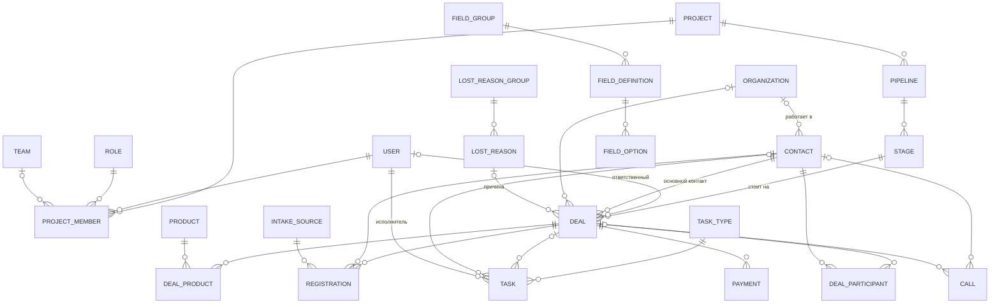

# Спецификация MVP своей CRM вместо Pipedrive

Статус: **черновик 1** (2026-11-04), собран без владельца из ответов тикетов карты.
Карта: [map.md](map.md). Термины: [GLOSSARY.md](../../GLOSSARY.md). Изоляция проектов: [ADR 0001](../../docs/adr/0001-izolyatsiya-proektov.md).

Каждое решение записано один раз, со ссылкой на тикет с подробностями. **Допущение** — пробел, который источники не закрывают, заполненный здесь очевидным вариантом. Тикеты 06, 10–15 решены без владельца по его поручению. Допущения и решения без владельца собраны в разделе 13 для подтверждения.

---

## 1. Цель и рамки

**Цель.** Своя CRM, которая заменяет Pipedrive (`franch.pipedrive.com`, ≈ €1,9 тыс./мес). Причины две: глубже связать CRM со своими системами (школа, оплаты, реклама, мессенджеры) и снизить расходы. Исходные условия — раздел Notes в [map.md](map.md).

**Первый пользователь** — проект AI-школы ALPI (Franch AI, B2C: вебинар → бронь → счёт → доплата). Проект «Франч» (B2B-консалтинг) переезжает вторым на ту же систему. Модель держит оба проекта с первого дня ([ADR 0001](../../docs/adr/0001-izolyatsiya-proektov.md)).

**Срок-ориентир:** 2–3 месяца до параллельного запуска для AI-школы (с даты начала реализации).

### 1.1 Входит в MVP

- Проекты, пользователи, роли, права, команды, вход с двухфакторной аутентификацией (2FA).
- Воронки, этапы, сделки, контакты, организации, участники сделки, товары, причины проигрыша.
- Регистрации и их приём по API от лендингов, вебинарной платформы, ManyChat и других источников.
- Задачи, следующая задача, календарь задач, лента карточки.
- Платежи через WayForPay, звонки Ringostat, курсы НБУ.
- Конструктор пользовательских полей; поиск, фильтры, массовые операции, архив, корзина.
- 5 фиксированных правил автоматики, уведомления внутри CRM, 7 отчётов и 2 панели.
- Эксплуатация: production и staging, резервные копии, мониторинг.
- Готовность модели к импорту из Pipedrive (без самого импорта).
- Интерфейс на украинском (по умолчанию) и русском, адаптивный веб для телефона.

### 1.2 Не входит в MVP

Из раздела Out of scope карты ([map.md](map.md)):

- Продажа CRM как SaaS и изолированные аккаунты для многих компаний.
- Отдельная сущность «лид».
- Нативное мобильное приложение.
- Сам перенос данных из Pipedrive.
- Переезд проекта «Франч»: его воронки, поля, планировщик встреч (подтвердить).
- Интеграции второй очереди: Telegram, Wazzup, ManyChat как мессенджер, KWIGA, Zenedu, Zapier (подтвердить).
- Конструктор автоматизаций и конструктор отчётов (подтвердить).

Из ответов тикетов:

- Поля-формулы, права на отдельные поля и на этапы, вход через Google ([06](issues/06-custom-fields.md), [07](issues/07-roles-and-visibility.md)).
- Google Calendar, планировщик встреч, уведомления по email, push и Telegram ([08](issues/08-activities.md)).
- Синхронизация с Pipedrive ([13](issues/13-parallel-with-pipedrive.md)); вариации товаров, скидки, регулярные платежи ([01](issues/01-core-data-model.md)).
- **Допущение:** click-to-call и отправка контактов в софтфон Ringostat — исследованы ([03](issues/03-external-apis.md)), но ни один тикет не включил их в MVP.

---

## 2. Термины

Все термины — по [GLOSSARY.md](../../GLOSSARY.md): проект, сделка, воронка, этап, валюта сделки, контакт, организация, участник сделки, регистрация, платёж, товар, причина проигрыша, допродажа, роль, право, команда, ответственный, возможный дубль, слияние, архив, корзина, задача, следующая задача, звонок.

Слова «лид» (кроме названия этапа «Новий лід»), «направление», «активность», «владелец сделки» не используются. Три понятия пока не в глоссарии, их предлагается внести (раздел 13):

- **Общая очередь** — сделки воронки без ответственного; менеджер берёт сделку и становится её ответственным ([10](issues/10-intake-and-pipeline-automation.md)).
- **Источник регистраций** — внешняя система, которая шлёт регистрации в CRM со своим ключом (лендинг, вебинарная платформа, ManyChat) ([10](issues/10-intake-and-pipeline-automation.md)).
- **Внешняя ссылка** — пара «система-источник + идентификатор записи в ней», например `pipedrive:12345` ([11](issues/11-import-readiness.md)).

---

## 3. Модель данных

Решения — [01](issues/01-core-data-model.md) (ядро), [06](issues/06-custom-fields.md) (поля), [07](issues/07-roles-and-visibility.md) (роли), [08](issues/08-activities.md) (задачи), [11](issues/11-import-readiness.md) (импорт).

### 3.1 Изоляция проектов

По [ADR 0001](../../docs/adr/0001-izolyatsiya-proektov.md):

- Каждая таблица бизнес-данных несёт `project_id`.
- Изоляцию обеспечивает сама PostgreSQL через row-level security (политика строк: запрос видит только строки текущего проекта). Ошибка в коде приложения не должна показать чужой проект.
- Каждый запрос приложения выполняется в контексте одного проекта: проект выставляется в сессии базы в начале транзакции.
- Вне проектов живут только: учётные записи пользователей и их сессии, курсы НБУ (`fx_rate`), служебные таблицы фоновых задач. Код, который их читает, явно работает вне политик.
- Поиск и отчёты — всегда в пределах одного проекта. Сделка не может перейти в другой проект.

### 3.2 Сущности

Все сущности, кроме отмеченных «глобальная», принадлежат одному проекту. У всех — `id`, `project_id`, `created_at`, `updated_at`, `created_by`.

| Сущность | Назначение | Ключевые поля | Связи | Инварианты |
|---|---|---|---|---|
| `project` (глобальная) | Отдельный бизнес | `code`, название, язык по умолчанию, часовой пояс | всё остальное | Данные двух проектов не пересекаются |
| `user` (глобальная) | Учётная запись | email, пароль, 2FA, язык интерфейса, `disabled` | `project_member` | Вход только с 2FA. Отключённый не входит, но остаётся в истории |
| `project_member` | Доступ пользователя к проекту | `user_id`, `role_id`, `team_id`, «принимает новые сделки», логин/номер в Ringostat | `user`, `role`, `team` | Одна роль в одном проекте |
| `role`, `role_permission` | Роль и её права | название, шаблон-источник, таблица прав, охват | `project_member` | Роль «администратор» не удаляется и не урезается; в проекте всегда ≥ 1 администратор |
| `team` | Команда менеджеров | название, `lead_user_id` | `project_member` | Один тимлид; менеджер ровно в одной команде; один уровень |
| `pipeline` | Воронка | название, `code`, порядок, режим назначения (очередь / по кругу + команда), правила оплаты, N дней задачи после выигрыша | `stage` | — |
| `stage` | Этап | название, порядок, `deleted_at` | `pipeline`, `deal` | Этап с открытыми сделками удалить нельзя |
| `deal` | Сделка | название, `pipeline_id`, `stage_id`, статус (open/won/lost), сумма, валюта (EUR/UAH/USD), `responsible_id`, `contact_id`, `organization_id`, причина проигрыша, `archived_at`, `won_at`/`lost_at`, `stage_changed_at`, ожидаемая дата закрытия, пометка «есть открытая сделка в Pipedrive», `custom` (JSONB) | всё ниже | Ровно один этап. Lost ⇒ причина обязательна. Одна валюта. Не больше одной открытой сделки на контакт в воронке. Ответственный ровно один, кроме сделок в общей очереди (раздел 13) |
| `contact` | Человек в проекте | имя, фамилия, телефоны и email (несколько, один «основной»), язык общения, `organization_id`, «возможный дубль», `custom` | `deal`, `registration`, `call` | Телефон хранится в E.164. Не больше одной организации. Ответственного нет |
| `organization` | Компания | название, адрес, сайт, `custom` | `contact`, `deal` | — |
| `deal_participant` | Участник сделки | `deal_id`, `contact_id`, роль участника (текст) | `deal`, `contact` | Основной контакт — в `deal.contact_id`, не дублируется здесь |
| `registration` | Регистрация | `deal_id`, `contact_id`, `source_id`, `event_id`, источник, `utm_*`, fbclid, gclid, страница, referrer, user agent, время, вебинар (id, название, дата), данные просмотра (начал, закончил, минуты, процент), `extra` (JSONB), «импортирована из Pipedrive» | `deal`, `contact`, `intake_source` | Всегда в сделке. `event_id` уникален в пределах источника. «Первая/последняя» вычисляются |
| `payment` | Платёж | `deal_id`, тип (бронь / рахунок / доплата), сумма в валюте сделки, сумма в UAH, курс WayForPay, `order_reference`, `invoice_url`, срок жизни, статус, `reason_code`, маскированная карта, комиссия, `processed_at`, сумма возврата | `deal`, `product` | Один `order_reference` — один платёж. «Оплачено» = сумма успешных платежей в валюте сделки |
| `product` | Товар | название, цены EUR/UAH/USD, архив | `deal_product` | Без вариаций и скидок |
| `deal_product` | Строка товара в сделке | `product_id`, количество, цена в валюте сделки | `deal`, `product` | **Допущение:** если у сделки есть строки, её сумма = сумма строк |
| `lost_reason_group`, `lost_reason` | Справочник причин проигрыша | группа → причина, порядок, архив | `deal` | Двухуровневый, свой в проекте |
| `task_type` | Тип задачи | название, значок, цвет, архив | `task` | Свой в проекте |
| `task` | Задача | тип, тема, дата, время и длительность (необязательно), исполнитель, `deal_id` и/или `contact_id`, заметка, `done_at` | `deal`, `contact`, `user` | Есть дата. Пользовательских полей нет |
| `call` | Звонок | `ringostat_call_id`, направление, номера (E.164), время, длительность, статус, менеджер, ссылки на запись, путь к своей копии записи | `contact`, `deal` | `ringostat_call_id` уникален. Событие ленты, не задача |
| `note`, `file` | Заметка, файл | текст / объект в хранилище, автор | сделка, контакт или организация | — |
| `change_log` | Журнал изменений | сущность, id, кто, когда, поле, было → стало | сделка, контакт, организация, платёж | Только добавление |
| `field_group`, `field_definition`, `field_option` | Конструктор полей | см. 3.3 | `custom` у сделки, контакта, организации | Код поля неизменен после первого значения |
| `external_link` | Внешняя ссылка | тип сущности, id, система, внешний id | любая из 3.4 | Уникальна в проекте по (тип, система, внешний id) |
| `intake_source` | Источник регистраций | название, хэш ключа, воронка по умолчанию, `revoked_at` | `registration` | Ключ определяет проект |
| `inbound_event` | Входящая таблица | канал (intake / wayforpay / ringostat), ключ дубля, сырое тело, проверка подписи, статус обработки, ошибка | — | Уникальна по (канал, ключ дубля) |
| `pipedrive_owner_hint` | Справочник «телефон/email → менеджер Pipedrive» | нормализованный телефон или email, `user_id` | `user` | Только эти поля ([13](issues/13-parallel-with-pipedrive.md)) |
| `saved_filter` | Сохранённый фильтр | владелец, видимость (личный / команда / проект), условия | — | — |
| `notification` | Уведомление в CRM | получатель, тип, ссылка, прочитано | `user` | — |
| `audit_log` | Журнал входов и опасных действий | кто, что, когда, IP | — | Только добавление |
| `fx_rate` (глобальная) | Курс НБУ | дата, валюта (EUR/USD), курс, `calcdate`, `special`, `fetched_at` | — | Уникален по (дата, валюта) |
| `bulk_job` | Массовая операция | фильтр, действие, прогресс, журнал | — | Выполняется фоновой задачей |

Удаление и архив ([01](issues/01-core-data-model.md)):

- Удалённые сделки и контакты 30 дней лежат в корзине (`deleted_at`), окончательно удаляет администратор. Архив — отметка, а не статус; автоархив — раздел 7.
- **Допущение:** организации тоже удаляются через корзину. Контакт, который основной в сделках, удаляется только вместе с ними (после подтверждения списка).
- **Допущение:** закрытые сделки удалённого этапа остаются на нём; этап помечается удалённым и пропадает из канбана, отчёты его показывают.

Правило «одна открытая сделка на контакт в воронке» ([01](issues/01-core-data-model.md)) проверяется не только при приёме регистрации.

- **Допущение:** повторное открытие сделки, перенос в другую воронку и слияние контактов запрещены, если нарушат это правило. CRM показывает конфликтующую сделку; пользователь сначала закрывает или переносит одну из них.

### 3.3 Пользовательские поля

Решение со всеми правилами — [06](issues/06-custom-fields.md). Для модели важно:

- Поля есть у сделок, контактов, организаций своего проекта; у задач и товаров — нет.
- 15 типов (в тикете написано «14», но перечислено 15 — раздел 13.2, п. 11), без формул. Поле — в одной группе; права ролей — на группу.
- Видимость по воронкам; обязательность «всегда» или «с этапа X»; отметка «важное».
- Стабильный латинский код поля — в API приёма, импорте и фильтрах. Варианты списков со стабильным id. Удаление поля с данными — через архив.
- Хранение — JSONB-колонка `custom` с GIN-индексом; «часто фильтруют» строит отдельный индекс ([02](issues/02-stack-and-hosting.md)).
- Системные поля в конструктор не входят. Рекламные и вебинарные данные — не поля, а регистрация.
- **Допущение:** название поля и вариантов хранится на украинском и русском (как советует исследование стека).

Конкретный набор полей ALPI появится после аудита полей Pipedrive ([05](issues/05-fields-usage-audit.md), заблокирован).

### 3.4 Внешние ссылки для импорта

Решение — [11](issues/11-import-readiness.md). Что заложено в модель уже в MVP:

- `external_link` у сделки, контакта, организации, пользователя, воронки, этапа, товара, задачи, заметки, причины проигрыша. Системы: `pipedrive`, `bitrix` (поле «Bitrix ID» Pipedrive становится такой ссылкой). Повторный импорт находит запись по ссылке и обновляет её.
- Даты создания, смены этапа, выигрыша и проигрыша, выполнения задачи можно записать из источника. Обычный интерфейс этого не позволяет — только импорт.
- Пользователь может существовать как отключённый без входа: ответственный по старым сделкам и автор истории.
- Регистрация несёт пометку «импортирована из Pipedrive». Журнал изменений получает событие «импортировано».

### 3.5 ER-диаграмма

Заметки, файлы, журнал изменений и внешние ссылки привязаны к нескольким типам сущностей (полиморфная связь) и на диаграмме не показаны.

---

## 4. Роли и права

Решение — [07](issues/07-roles-and-visibility.md). Права действуют внутри одного проекта.

**Роль** — таблица «часть системы × действие».

- Части системы: сделки, контакты, организации, задачи, платежи, товары, отчёты, воронки и этапы, поля, пользователи и роли, интеграции, корзина.
- Действия: смотреть, создавать, изменять, удалять.
- Отдельные права: выгрузка в файл, массовые операции, передача сделок другому, доступ к настройкам проекта.
- **Допущение:** отдельное право «общие фильтры» — сохранять фильтры для команды и проекта ([15](issues/15-search-and-scale.md) говорит «по праву», но в списке [07](issues/07-roles-and-visibility.md) такого нет).

**Охват** для сделок, контактов, задач, платежей: только свои / своей команды / все в проекте. Охват задаётся отдельно для чтения и для изменения («видеть всё, менять только свои»).

- «Свои» сделки — где пользователь ответственный. «Своей команды» — где ответственный из команды, которую ведёт тимлид.
- **Допущение:** у контакта нет ответственного, поэтому «свой» контакт — тот, который основной или участник в доступной пользователю сделке, либо создан им.
- **Допущение:** сделки общей очереди видят все, у кого есть право «сделки: смотреть» в этой воронке, независимо от охвата. Иначе менеджер с охватом «свои» не сможет взять сделку.

**Права на группы полей:** «видно и можно менять» / «только чтение» / «скрыто».

**Чужой клиент.** Менеджер ищет или создаёт контакт, а телефон совпал с контактом вне его охвата. Тогда менеджер видит «клиент уже в работе у <менеджер>», без содержимого сделки.

**Шаблоны ролей** создаются в каждом новом проекте; их можно менять, копировать и добавлять свои. Решено: выгрузка по умолчанию только у администратора; удаление и массовые операции — у администратора и руководителя. Остальные значения таблицы — **допущение**:

_«всё» в таблице = смотреть, создавать, изменять и удалять._

| Право | Администратор | Руководитель | Тимлид | Менеджер |
|---|---|---|---|---|
| Сделки, контакты, задачи, платежи — охват | все | все | команда | свои |

| … смотреть / создавать / изменять | да | да | да | да |
| … удалять | да | да | нет | нет |
| Организации | всё | всё | смотреть, создавать, изменять | смотреть, создавать, изменять |
| Товары, причины, типы задач | всё | смотреть | смотреть | смотреть |
| Отчёты (охват как у сделок) | да | да | да | нет (только своя панель) |
| Воронки и этапы, поля, интеграции, пользователи и роли, настройки проекта | да | нет | нет | нет |
| Корзина | всё, включая окончательное удаление | смотреть, восстанавливать | нет | нет |
| Выгрузка в файл | да | нет | нет | нет |
| Массовые операции | да | да | нет | нет |
| Передача сделок другому | да | да | в своей команде | нет |
| Общие фильтры | да | да | для команды | нет |

**Пользователи и вход:**

- Вход — email, пароль и обязательная 2FA через приложение кодов. **Допущение:** выдаются одноразовые коды восстановления.
- Своей регистрации нет: пользователей создаёт администратор ([02](issues/02-stack-and-hosting.md)). Учётная запись одна на систему, доступ и роль — на каждый проект, в интерфейсе — переключатель проекта.
- **Допущение:** проекты создаёт и первых администраторов назначает «владелец системы» — отдельный флаг учётной записи вне проектов.

**Уход сотрудника.** Отключить пользователя с открытыми сделками нельзя, пока сделки не переданы: вручную или равномерно по команде. Отключённый остаётся в истории, его сессии отзываются.

---

## 5. Экраны и сценарии

Грубый прототип строится в [docs/prototypes/crm-mvp-screens/index.html](../../docs/prototypes/crm-mvp-screens/index.html) (тикет [09](issues/09-mvp-screens.md) открыт). Описание ниже собрано из решений других тикетов. После реакции владельца на прототип раздел уточняется.

Общее для всех экранов:

- Шапка: переключатель проекта, быстрый поиск, уведомления, язык. Всё показывается в пределах текущего проекта и охвата роли.
- Интерфейс работает на телефоне. Канбан на узком экране — одна колонка с переключателем этапов (**допущение**).

### 5.1 Канбан воронки

- Колонки — этапы. Карточка: название, контакт, сумма с валютой, ответственный, индикатор следующей задачи.
- В шапке колонки — количество и суммы по этапу. Их считает отдельный запрос агрегатов, а не загруженные карточки ([15](issues/15-search-and-scale.md)).
- **Допущение:** суммы по этапу показываются отдельно по каждой валюте и итогом в UAH по сегодняшнему курсу НБУ.
- Колонка грузит ~50 карточек и подгружает остальные при прокрутке. Первый этап ALPI показывает «ещё N — открыть списком».
- Перетаскивание меняет этап. Обязательные поля «с этапа X» проверяются, при пустых — форма их заполнения.
- Зоны «выиграна» и «проиграна» при перетаскивании. Проигрыш требует причину (группа → причина).
- Фильтры — те же, что у списка (5.3); архивные сделки не показываются. Общая очередь: фильтр «без ответственного» и кнопка «взять в работу» на карточке.

### 5.2 Карточка сделки

- Шапка: название, этап с переходом, статус, сумма и валюта, «оплачено», ответственный, кнопки «выиграна», «проиграна», «в архив», «открыть заново».
- Блок «что сделать дальше»: следующая задача и кнопка новой задачи.
- Контакт и организация с телефонами и email. Участники с ролями. Пометки «возможный дубль» и «есть открытая сделка в Pipedrive».
- Строки товаров. Платежи и кнопка «Виставити рахунок» (раздел 6.2).
- Пользовательские поля по группам, с учётом видимости по воронке и прав на группы.
- Регистрации — список всех, с рекламными данными и данными просмотра вебинара.
- Лента: изменения, заметки, файлы, регистрации, платежи, задачи, звонки (с прослушиванием записи) — по времени, с фильтром по типу.
- **Допущение:** кнопка «создать допродажу» на выигранной сделке открывает новую сделку в воронке допродаж с тем же контактом.
- Карточки контакта и организации устроены так же: поля, сделки, лента.

### 5.3 Список сделок (и контактов, организаций)

- Таблица с выбором колонок, сортировкой и курсорной подгрузкой. Для больших результатов — счётчик «≈».
- Фильтры: системные и пользовательские поля, индикатор следующей задачи, данные регистраций (источник, кампания, вебинар), архив. Группы условий И/ИЛИ.
- Сохранённые фильтры: личные, для команды, для проекта.
- Массовые действия над выбранным или над всем результатом фильтра: архивировать, передать, сменить этап, удалить. Выполняются фоновой задачей с прогрессом и журналом. Права — раздел 4.
- Главный сценарий: архивировать старые сделки «Новий лід» фильтром «этап = первый, создана раньше даты».
- Выгрузка в CSV — по праву «выгрузка в файл».

### 5.4 Быстрый поиск, календарь, панели

- **Быстрый поиск** ([15](issues/15-search-and-scale.md)): имя контакта, телефон в любом формате (приводится к E.164), email, название сделки, организация. Результаты сгруппированы по типу, архивные сделки находятся. Полнотекстовый поиск и триграммы PostgreSQL, без отдельного поискового сервиса.
- **Календарь задач** ([08](issues/08-activities.md)): вид «день» и «неделя»; задачи на время — в сетке, «на день» — над ней; фильтр по исполнителю (в охвате) и типу. Рядом — список задач: просроченные, сегодня, будущие. После выполнения — предложение запланировать следующую, можно отказаться.
- **Панели** ([12](issues/12-mvp-reports.md)): менеджера «на сегодня» — свои задачи, просроченные, новые сделки в общей очереди; руководителя — ключевые числа отчётов 2, 3 и 5 (раздел 8) за сегодня и неделю.

### 5.5 Настройки проекта

Доступ — по праву «доступ к настройкам проекта» и правам на соответствующие части системы.

- **Воронки и этапы:** создание, порядок этапов, удаление этапа без открытых сделок. Настройки воронки: режим назначения (общая очередь / по кругу + команда), этапы для успешных брони, счёта и доплаты, N дней задачи после выигрыша, тип этой задачи.
- **Поля:** конструктор (3.3), группы, права ролей на группы.
- **Роли и пользователи:** конструктор ролей, шаблоны, команды и тимлиды, приглашение, отключение с передачей сделок, флаг «принимает новые сделки».
- **Товары:** каталог с ценами EUR/UAH/USD, архив.
- **Причины проигрыша:** группы и причины, порядок, архив.
- **Типы задач:** название, значок, цвет, архив. Стартовый набор — типы ALPI из Pipedrive без тестовых и неиспользуемых ([08](issues/08-activities.md)).
- **Интеграции:** источники регистраций и их ключи (создать, отозвать); мерчант WayForPay (аккаунт, секретный ключ, домен); проект Ringostat (`Auth-key`, project id, логины менеджеров, схема общей линии); загрузка справочника менеджеров Pipedrive.
- **Корзина:** восстановление и окончательное удаление.

---

## 6. Интеграции

Ограничения внешних API — из отчёта `docs/research/external-apis.md` на ветке `origin/research/external-apis` ([03](issues/03-external-apis.md)).

Общий приём входящих вызовов для всех трёх каналов — по [02](issues/02-stack-and-hosting.md):

1. Проверить подпись или ключ.
2. Записать сырое тело в `inbound_event`. Повтор с тем же ключом дубля не создаёт вторую запись.
3. Сразу ответить.
4. Обработать фоновой задачей (pg-boss).

Застрявшие события видны в мониторинге (раздел 9).

### 6.1 Приём регистраций

Решение — [10](issues/10-intake-and-pipeline-automation.md).

**Адрес:** `POST /api/intake/registrations`. Один на систему; проект определяет ключ.

**Аутентификация:** заголовок `Authorization: Bearer <ключ источника>`. Ключ свой у каждого источника регистраций, его можно отозвать. **Допущение:** CRM хранит только хэш ключа; ключ показывается один раз при создании.

**Тело (JSON):**

| Поле | Обязательно | Смысл |
|---|---|---|
| `event_id` | да (**допущение**) | Id события в источнике; ключ идемпотентности в пределах источника |
| `first_name`, `last_name` | нет | Имя |
| `phone` | одно из двух | Любой формат, CRM приводит к E.164 (**допущение:** без кода страны — Украина) |
| `email` | одно из двух | — |
| `language` | нет | `uk` / `ru` / другое — язык общения контакта |
| `pipeline_code` | нет | Иначе — воронка источника по умолчанию |
| `webinar` | нет | `{ id, name, date }` |
| `ad` | нет | `{ source, utm_source, utm_medium, utm_campaign, utm_content, utm_term, fbclid, gclid, page_url, referrer, user_agent }` |
| `occurred_at` | нет | Время регистрации в источнике; иначе — время приёма |
| `custom` | нет | Значения пользовательских полей сделки по кодам полей (**допущение**) |
| `extra` | нет | Всё прочее; сохраняется как есть |

**Ответы (допущение):**

- `202` — принято, в теле `intake_id`; `200` — повтор того же `event_id`, в теле тот же `intake_id`.
- `400` — нет ни телефона, ни email, или неверный JSON; `401` — ключ неверен или отозван.

**Обработка в фоне:**

1. Найти контакт: по телефону, затем по email. Если телефон указывает на одного человека, а email на другого — пометка «возможный дубль». **Допущение:** регистрация идёт к контакту, найденному по телефону.
2. Нет контакта — создать.
3. Найти открытую неархивную сделку контакта в воронке. Есть — регистрация в неё. Нет (или только закрытая, или архивная) — новая сделка на первом этапе.
4. **Допущение:** название новой сделки — «Имя Фамилия — название вебинара или источник».
5. Назначить ответственного новой сделке (раздел 7, правило 5). Сначала проверяется справочник менеджеров Pipedrive ([13](issues/13-parallel-with-pipedrive.md)): при совпадении телефона или email сделка отдаётся тому менеджеру и получает пометку «есть открытая сделка в Pipedrive». **Допущение:** если этот менеджер не заведён в новой CRM, сделка идёт обычным порядком.

**Данные просмотра вебинара:** `POST /api/intake/webinar-views`, тот же ключ. Тело: `event_id`, `phone` и/или `email`, `webinar.id`, `started_at`, `finished_at`, `minutes`, `percent`. **Допущение:** обновляется последняя регистрация этого контакта на этот вебинар; если такой нет, событие помечается «не сопоставлено» и видно администратору.

Какие источники регистраций переключать на этот адрес — из тикета [04](issues/04-registration-flow.md) (заблокирован).

### 6.2 WayForPay

Решение — [10](issues/10-intake-and-pipeline-automation.md), ограничения — [03](issues/03-external-apis.md).

**Выставить счёт** (кнопка «Виставити рахунок» в карточке):

- Пользователь выбирает тип (бронь / рахунок / доплата), товар, сумму в валюте сделки и срок жизни счёта (по умолчанию 72 часа).
- CRM вызывает `CREATE_INVOICE` со своим `orderReference` и явным `orderTimeout` (у WayForPay по умолчанию 1 час). **Допущение:** формат `orderReference` — `{код проекта}-{id сделки}-{номер платежа}`.
- Списание идёт только в UAH; сделка в EUR или USD передаётся как `alternativeCurrency`. CRM хранит сумму в валюте сделки, сумму в UAH и курс WayForPay.
- `invoiceUrl` показывается в карточке для копирования. **Допущение:** если у контакта есть email, WayForPay отправляет счёт сам (`notifyMethod=email`).
- **Допущение:** неоплаченный счёт можно отменить из карточки (`REMOVE_INVOICE`).

**Колбэк `serviceUrl`:**

- Подпись HMAC-MD5 проверяется по исходной строке JSON (форматирование чисел ломает подпись). Ключ дубля — `orderReference` + статус.
- CRM отвечает подписанным `accept`. Без ответа WayForPay повторяет колбэк до 4 суток, и колбэк приходит на каждую смену статуса — обработчик идемпотентен.

**Статусы платежа** (**допущение** о соответствии):

| Статус WayForPay | Статус платежа в CRM |
|---|---|
| `InProcessing`, `Pending`, `WaitingAuthComplete` | в обработке |
| `Approved` | успешен |
| `Declined` | отклонён |
| `Expired` | истёк |
| `Refunded`, `Voided` | возвращён |
| `RefundInProcessing` | возврат в обработке |

**Правила воронки** — раздел 7, правило 1.

**Возвраты.** Возврат — платёж «возвращён», сделка сама не переоткрывается, ответственному ставится задача. **Допущение:** в MVP возврат делается в кабинете WayForPay; CRM узнаёт о нём из колбэка или ночной сверки.

**Ночная сверка — допущение.** Исследование говорит, что колбэк может не дойти. Поэтому раз в сутки CRM запрашивает `TRANSACTION_LIST` за прошедшие сутки, а для платежей в обработке старше часа — `CHECK_STATUS`.

**Тесты** — на тестовом мерчанте WayForPay. До начала эпика нужен один настоящий платёж в EUR, чтобы увидеть поля колбэка (раздел 13).

### 6.3 Ringostat

Решения — [08](issues/08-activities.md) и [10](issues/10-intake-and-pipeline-automation.md), ограничения — [03](issues/03-external-apis.md).

- **Маршрутизация входящего** (webhook forwarding number). Ringostat спрашивает CRM, куда направить звонок. CRM приводит номер к E.164 и ищет контакт. Если у контакта есть открытая сделка — отвечает `dst_callee` с логином её ответственного. Иначе — схема общей линии.
- **Допущение:** CRM отвечает на запрос маршрутизации за ≤ 300 мс из индекса по телефону. Поведение Ringostat при неответе не проверено (раздел 13).
- **Вебхуки звонков** (входящий и исходящий, после звонка) пишутся в `inbound_event`, ключ дубля — `call_id`. Фоновая задача создаёт `call` и привязывает его к контакту по номеру. **Допущение:** звонок привязывается к открытой сделке контакта, где менеджер звонка — ответственный; иначе к последней изменённой открытой сделке.
- Имена полей в событиях Ringostat разные (`call_id` / `callid`), набор полей задаётся в кабинете вручную. Контракт фиксируется на стороне CRM и проверяется тестом на образцах.
- **Допущение:** вебхуки защищены Basic-аутентификацией и секретом в URL.
- **Пропущенный входящий** — задача «Передзвонити» ответственному сделки (раздел 7, правило 2).
- **Ночная сверка:** `GET /calls/list` за прошедшие сутки добавляет пропущенные вебхуком звонки.
- **Записи разговоров** Ringostat хранит гарантированно 1 год. Нужные записи CRM копирует в своё объектное хранилище сразу после звонка. **Допущение:** «нужные» — все записи звонков, привязанных к контакту.
- Связь пользователя с Ringostat — логин или номер менеджера в `project_member`.

### 6.4 НБУ

Ограничения — [03](issues/03-external-apis.md).

- `fx_rate` — глобальная таблица: курс EUR и USD к UAH на каждую календарную дату, включая выходные.
- Запрос — всегда по явной дате (`?valcode=EUR&date=YYYYMMDD&json`). Дата считается в часовом поясе Europe/Kyiv. «Текущий» курс после 15:30 — уже завтрашний.
- Пустой ответ `[]` значит «курса ещё нет»: повторить позже, не ошибка. Разбор ответа терпим к новым полям. Курс на прошедшую дату кешируется навсегда.
- **Допущение:** фоновая задача в 16:30 по Киеву берёт курс на завтра. Отсутствующие даты дозапрашиваются при первом обращении.
- Использование — только отчёты (раздел 8). В счёт WayForPay идёт курс WayForPay, а не НБУ.

---

### 6.x Исходящие вебхуки и правила источников (из тикета [04](issues/04-registration-flow.md); решено без владельца — подтвердить)

- **Исходящие вебхуки** входят в MVP: события «сделка изменена», «задача изменена», «платёж изменён» отправляются на адреса, заданные администратором проекта. Только HTTPS, подпись HMAC, повторы с нарастающей паузой, журнал доставок. Нужны для конверсий Google Analytics и сервисов расшифровки (сейчас 3 вебхука Pipedrive).
- **Правила источника регистраций** (настройка источника, не конструктор автоматизаций): «создать задачу при регистрации» (тип, срок — например «в тот же день»; заменяет автоматизацию «Консультації») и «заполнить поле значением» (заменяет «KZ»).
- Источники для переключения в день запуска — 10 потоков из `docs/research/pipedrive-intake-flows.md`.

## 7. Автоматика и уведомления

Решение — [10](issues/10-intake-and-pipeline-automation.md). В MVP пять фиксированных правил с настройками в воронке или проекте. Конструктора автоматизаций нет. Каждое срабатывание пишется в журнал изменений с автором «система».

| № | Правило | Настройка | Где описано |
|---|---|---|---|
| 1 | Успешная бронь → этап «Бронь». Успешный счёт или доплата → этап по настройке. «Оплачено» ≥ суммы сделки → сделка выиграна. Возврат → задача ответственному | Этапы в воронке | [10](issues/10-intake-and-pipeline-automation.md) |
| 2 | Пропущенный входящий звонок → задача «Передзвонити» ответственному сделки | Тип задачи | [08](issues/08-activities.md) |
| 3 | Раз в сутки — автоархив сделок первого этапа без активности 30 дней | Срок, вкл/выкл в воронке | [01](issues/01-core-data-model.md) |
| 4 | После выигрыша — задача ответственному через N дней | N (по умолчанию 90), тип задачи | [10](issues/10-intake-and-pipeline-automation.md) |
| 5 | Новая сделка в воронке с режимом «по кругу» → ответственный по очереди среди менеджеров выбранной команды с флагом «принимает новые сделки» | Режим и команда в воронке | [10](issues/10-intake-and-pipeline-automation.md) |

Уточнения (все — **допущения**):

- Правило 1: этап меняется только вперёд по порядку воронки. Автовыигрыш — только если сумма сделки больше нуля (у большинства сделок ALPI сумма 0). Обязательные поля автоматику не блокируют; в карточке они подсвечиваются.
- Правило 2: если у контакта нет открытой сделки или номер неизвестен, задача идёт пользователю, назначенному в настройках Ringostat «ответственным за неизвестные звонки».
- Правило 3: «активность» — новая регистрация, задача, заметка, звонок, платёж или смена этапа.
- Правило 5: сделка по кругу не назначается, если её уже забрал справочник менеджеров Pipedrive или у контакта есть открытая сделка с ответственным.

Для первой воронки ALPI по умолчанию — общая очередь: тысячи сырых регистраций не раздаются менеджерам автоматически.

**Уведомления** — только внутри CRM ([08](issues/08-activities.md)):

- Напоминание за N минут до задачи со временем (**допущение:** N = 15, меняется пользователем).
- Утренний список задач на сегодня.
- **Допущение:** уведомление, когда тебе назначили сделку или задачу и когда массовая операция завершилась.

Email, push и Telegram — вторая очередь.

---

## 8. Отчёты

Решение — [12](issues/12-mvp-reports.md). Фиксированный набор, без конструктора.

Общие правила:

- Все отчёты — в пределах одного проекта. Доступ — по праву «отчёты», данные — в охвате роли.
- Общие фильтры: период, воронка, команда, менеджер, источник рекламы (по первой или последней регистрации), вебинар.
- Суммы приводятся к UAH по курсу НБУ: для сделок — на дату закрытия, для платежей — на дату платежа. Переключатель «в исходной валюте» показывает разбивку EUR/UAH/USD.
- **Допущение:** открытые сделки пересчитываются по курсу на дату построения отчёта.
- Выгрузка в CSV — по праву «выгрузка в файл».

| № | Отчёт | Содержание |
|---|---|---|
| 1 | Воронка | Сделки по этапам, конверсия этап → этап, среднее время на этапе |
| 2 | Результативность менеджеров | Взято в работу, задачи выполнены и просрочены, звонки, выиграно и проиграно, сумма оплат |
| 3 | Источники и реклама | Регистрации, сделки, оплаты, выручка по источнику, `utm_campaign`, вебинару |
| 4 | Регистрации на вебинары | Регистрации, просмотры, конверсия в бронь и оплату по вебинару |
| 5 | Деньги | Брони, касса по дням, дебиторка (открытые счета и недоплата), возвраты |
| 6 | Допродажи | Сделки и выручка воронки допродаж |
| 7 | Причины проигрыша | По группам и причинам, по менеджерам |

- **Допущение:** «вебинар» — не отдельная сущность, а данные регистрации. Список вебинаров для фильтра собирается из регистраций по `webinar.id`.
- Для отчёта 1 нужна история смены этапов — её даёт журнал изменений.
- Тяжёлые отчёты не должны тормозить работу менеджеров (раздел 9). **Допущение:** при необходимости — ночные агрегаты.

---

## 9. Нефункциональные требования

### 9.1 Объём и скорость

Решения — [15](issues/15-search-and-scale.md), оценки — [02](issues/02-stack-and-hosting.md).

- Объём: 500 тыс. – 1 млн сделок в проекте ALPI за несколько лет (сейчас ≈ 86 тыс. открытых). Около 30 пользователей. База — оценочно 5–30 ГБ за 2–3 года.
- Список и канбан — до 1 с при 500 тыс. сделок в проекте. **Допущение:** быстрый поиск — тоже до 1 с.
- Приём регистраций и вебхуков отвечает сразу после записи во входящую таблицу. **Допущение:** до 300 мс.
- Массовые операции — фоновой задачей с прогрессом. До запуска — нагрузочный тест на 500 тыс. сгенерированных сделок.

### 9.2 Безопасность

Решения — [07](issues/07-roles-and-visibility.md), [14](issues/14-operations.md).

- Обязательная 2FA; изоляция проектов row-level security (3.1); подписи и ключи у всех входящих каналов (раздел 6); только HTTPS.
- Журнал входов и опасных действий: удаление, выгрузка, смена ролей и прав, отключение пользователя, отзыв ключей.
- Секреты — только в переменных окружения сервера. **Допущение:** секреты интеграций проекта (секретный ключ WayForPay, `Auth-key` Ringostat), которые вводятся в настройках, хранятся в базе зашифрованными ключом из окружения.
- Обновления Better Auth, Node и образов — по выходу исправлений безопасности (автоматические PR зависимостей).

### 9.3 Резервные копии

Решение — [14](issues/14-operations.md).

- Ежедневный полный дамп PostgreSQL + непрерывный архив журнала (WAL) для восстановления на момент времени.
- Копии шифруются и хранятся вне Railway (внешнее S3-хранилище в ЕС; какое именно — решается в тикете 10 эпика `crm-foundation`): 30 ежедневных + 12 ежемесячных. Записи звонков и файлы — в объектном хранилище с копией.
- Восстановление раз в месяц автоматически проверяется на staging.

### 9.4 Мониторинг

Решение — [14](issues/14-operations.md).

- Доступность снаружи, ошибки приложения (Sentry или аналог), метрики сервера и базы, очередь фоновых задач и входящая таблица (застрявшие и упавшие события). Оповещения владельцу — в Telegram.
- **Допущение:** оповещение, если ночная сверка WayForPay или Ringostat нашла расхождение или не выполнилась, и если курс НБУ на завтра не получен к 18:00.

### 9.5 Персональные данные

Решение — [14](issues/14-operations.md).

- Серверы в ЕС; staging — на обезличенных данных.
- Удаление контакта по запросу человека (из корзины — сразу окончательно, по праву администратора) и выгрузка данных одного контакта.
- Юридический разбор GDPR и украинского закона о защите персональных данных — вне спецификации, это риск (раздел 13).
- Данные карт, кроме маскированного номера, не хранятся; токен карты WayForPay (`recToken`) не сохраняется — регулярных платежей в MVP нет ([03](issues/03-external-apis.md)).

### 9.6 Язык и время

- Интерфейс на украинском по умолчанию и на русском. Язык выбирает пользователь. Множественные формы и форматы дат, чисел и валют проверяются тестами ([02](issues/02-stack-and-hosting.md)).
- **Допущение:** часовой пояс системы и всех «дат» (дата закрытия, дата платежа, «сегодня» у задач) — Europe/Kyiv.

---

## 10. Стек и хостинг

**Утверждено владельцем 2026-11-04**, кроме хостинга: вместо Hetzner — Railway ([ADR 0002](../../docs/adr/0002-hosting-railway.md)). Исходная рекомендация — [02](issues/02-stack-and-hosting.md), отчёт `docs/research/stack-and-hosting.md` на ветке `origin/research/stack-and-hosting`.

| Слой | Рекомендация |
|---|---|
| Сервер: API, вебхуки, фоновые задачи | Hono на Node.js |
| Клиент | React SPA на Vite, TanStack Router, TanStack Query; без SSR и React Server Components |
| База | PostgreSQL 18 |
| Доступ к базе | Kysely 0.29 + kysely-codegen |
| Пользовательские поля | JSONB + таблица описаний + GIN `jsonb_path_ops` + индексы на «часто фильтруют» |
| Аутентификация | Better Auth 1.7.x, плагин admin, всегда последний патч |
| Фоновые задачи | pg-boss в том же PostgreSQL, без Redis |
| Переводы | i18next / react-i18next, `uk` и `ru` |
| Код | Один TypeScript-монорепозиторий; типы API доходят до клиента через Hono RPC |

Хостинг и развёртывание ([14](issues/14-operations.md)):

- **Railway** (решение владельца 2026-11-04, [ADR 0002](../../docs/adr/0002-hosting-railway.md)): один проект Railway, два окружения — staging и production, регион ЕС. Службы: PostgreSQL 18 с томом, API, web, обработчик фоновых задач (pg-boss). TLS и домены — средствами Railway, без своего обратного прокси.
- Образы собираются из тех же Dockerfile, что проверяет CI. Staging обновляется при слиянии в main после зелёной проверки GitHub, production — ручным действием. Миграции — отдельный шаг перед запуском API (служебная роль), API работает ролью без обхода RLS. Откат — предыдущий деплой Railway.
- Docker Compose остаётся для локальной разработки.
- Проверить при развёртывании (тикет 10 эпика `crm-foundation`): доступная версия PostgreSQL и возможность поставить 18; резервные копии тома и восстановление на момент времени (WAL) — средствами Railway или своим архивом во внешнее S3-хранилище; объектное хранилище для записей звонков и файлов; цена на тарифе Pro при нашей нагрузке; задержка из Украины.
- ~~Hetzner Cloud CX43 + Docker Compose + Caddy~~ — исходная рекомендация, заменена.

---

## 11. Переход с Pipedrive

### 11.1 Параллельная работа

Решение — [13](issues/13-parallel-with-pipedrive.md).

- Синхронизации между системами нет. Старые сделки дорабатываются в Pipedrive до закрытия или до импорта.
- В дату запуска источники регистраций переключаются на адрес приёма новой CRM (список — из [04](issues/04-registration-flow.md)). С этой даты Pipedrive новых сделок не получает.
- Человек из старой сделки Pipedrive, зарегистрировавшись снова, получает новую сделку в новой CRM — это допустимо. Чтобы с ним не работали два менеджера, до запуска загружается справочник «телефон/email → ответственный в Pipedrive» (разовая выгрузка только этих полей; применение — 6.1, шаг 5).
- Ringostat переключается на новую CRM в день запуска. Звонки по старым сделкам видны в Ringostat и в новой CRM (по номеру).
- Pipedrive отключается по решению владельца: когда открытых сделок в нём меньше порога (например 5 % от исходных) или после импорта. Тариф Pipedrive уменьшается по мере перевода менеджеров.

### 11.2 Готовность к импорту

Модель в MVP содержит всё из 3.4. Правила самого импорта — соответствия этапов, причин проигрыша и полей, перенос отключённых пользователей, заметок и задач, сопоставление дублей, хранение исходной выгрузки — записаны в [11](issues/11-import-readiness.md) и выполняются будущей работой по импорту, не в MVP.

### 11.3 Что добавят заблокированные тикеты

Оба ждут доступа владельца к Pipedrive и Zapier.

- [04 — Как регистрации сейчас попадают в Pipedrive](issues/04-registration-flow.md):
  - список потоков «источник → способ → поля» — по нему заводятся источники регистраций с ключами и составляется план переключения в день запуска;
  - проверка, что тело запроса 6.1 покрывает все поля, которые сейчас приходят;
  - что делают 4 автоматизации Pipedrive — проверка, что 5 фиксированных правил (раздел 7) их заменяют.
- [05 — Какие поля Pipedrive реально используются](issues/05-fields-usage-audit.md):
  - перечень пользовательских полей ALPI с типами, группами, вариантами списков и обязательностью по этапам — стартовая настройка проекта;
  - решения «перенести / объединить / выбросить» — таблица соответствия полей для импорта.

### 11.4 Готовность к параллельному запуску (допущение)

- Эпики 1–9 (раздел 12) закрыты, нагрузочный тест пройден, восстановление из копии проверено.
- В проекте ALPI настроены воронки, этапы, поля, роли, товары, причины, типы задач; пользователи заведены и включили 2FA.
- Все источники из [04](issues/04-registration-flow.md) заведены и проверены тестовой регистрацией на staging. Это условие запуска зависит от тикета 04, который ждёт доступа владельца к Pipedrive: без него список источников составляется с владельцем вручную.
- Справочник менеджеров Pipedrive загружен. Тестовый платёж WayForPay и тестовый звонок Ringostat прошли на production.

---

## 12. Эпики реализации

Вертикальные срезы в порядке зависимости. Каждый эпик заканчивается рабочим кусочком на staging. Ориентир по сроку — 2–3 месяца на все девять.

**Эпик 1. Каркас, вход, проекты, роли.**

- Входит: монорепозиторий; Docker Compose; CI с выкладкой на staging; схема с `project_id` и row-level security; пользователи, 2FA, сессии; проекты и переключатель; конструктор ролей, шаблоны, охват; команды; журнал входов и опасных действий; i18n `uk`/`ru`; каркас адаптивного интерфейса; таблица `external_link`.
- Готово, когда: администратор входит с 2FA, создаёт проект, роли и пользователей. Тест доказывает, что запрос в контексте проекта A не видит строк проекта B даже без фильтра в коде. Выкладка на staging идёт из main автоматически.

**Эпик 2. Воронки, сделки, контакты, организации.**

- Входит: воронки и этапы; сделки со статусами, причинами проигрыша, архивом, повторным открытием, переносом между воронками; контакты с телефонами в E.164 и email; организации; участники; товары и строки товаров; журнал изменений; заметки и файлы; корзина; канбан с подгрузкой и агрегатами; карточки; список с фильтрами по системным полям; быстрый поиск; «чужой клиент»; передача сделок при отключении пользователя.
- Готово, когда: менеджер ведёт сделку от создания до выигрыша или проигрыша в канбане и карточке; охват роли соблюдается в канбане, списке и поиске; правило «одна открытая сделка в воронке» не нарушается ни одним путём.

**Эпик 3. Регистрации и приём.**

- Входит: источники регистраций и ключи; `POST /api/intake/registrations` и `/webinar-views`; входящая таблица; поиск контакта, «возможный дубль», слияние контактов; общая очередь и режим «по кругу» (правило 5); справочник менеджеров Pipedrive; список регистраций в карточке; фильтры по регистрациям; массовые операции фоновой задачей; автоархив (правило 3).
- Готово, когда: повторная отправка того же `event_id` не создаёт дубля; регистрация попадает в открытую сделку или создаёт новую по правилам 6.1; 100 тыс. сгенерированных сделок первого этапа архивируются массовой операцией с прогрессом.

**Эпик 4. Задачи, лента, календарь.**

- Входит: типы задач; задачи на день и на время; индикатор следующей задачи с сортировкой и фильтром; предложение следующей задачи; календарь «день» и «неделя»; список задач; единая лента карточки; уведомления в CRM; панель менеджера «на сегодня»; задача после выигрыша (правило 4).
- Готово, когда: у каждой открытой сделки в канбане и списке верный индикатор; напоминание приходит за N минут; после выигрыша создаётся задача через N дней.

**Эпик 5. Платежи WayForPay и курсы НБУ.**

- Входит: таблица платежей; «Виставити рахунок» с `CREATE_INVOICE`; отмена счёта; колбэк с проверкой подписи и подписанным `accept`; статусы платежей; «оплачено»; правило 1; возвраты из колбэка; ночная сверка; загрузка курсов НБУ; настройки мерчанта.
- Готово, когда: на тестовом мерчанте счёт оплачивается, сделка переходит на этап и выигрывается; повтор колбэка 10 раз ничего не меняет; сверка находит платёж с потерянным колбэком; курс НБУ за выходные берётся верно.

**Эпик 6. Ringostat.**

- Входит: настройки проекта Ringostat и логины менеджеров; маршрутизация входящего; вебхуки звонков; звонки в ленте с прослушиванием; копирование записей; задача «Передзвонити» (правило 2); ночная сверка `calls/list`.
- Готово, когда: тестовый входящий звонок уходит ответственному сделки; звонок появляется в ленте сделки и контакта; пропущенный звонок создаёт задачу; сверка добавляет звонок с потерянным вебхуком.

**Эпик 7. Конструктор полей.**

- Входит: группы, 15 типов, видимость по воронкам, обязательность «всегда» и «с этапа X», «важное», коды, варианты, безопасная смена типа, архив полей; права ролей на группы; поля в карточке, списке, фильтрах, сохранённых фильтрах, API приёма; индексы «часто фильтруют»; стартовые поля ALPI (после [05](issues/05-fields-usage-audit.md)).
- Готово, когда: администратор создаёт поле, и оно сразу доступно в карточке, фильтре и API приёма по коду; сделку нельзя руками перевести на этап X с пустым обязательным полем; группа «скрыто» не приходит в ответе API.

**Эпик 8. Отчёты и панели.**

- Входит: 7 отчётов; общие фильтры; пересчёт в UAH по НБУ и режим «в исходной валюте»; панель руководителя; выгрузка в CSV.
- Готово, когда: на сгенерированных данных числа отчётов сходятся с прямыми SQL-запросами; охват роли соблюдается; отчёт за год строится не дольше нескольких секунд (**допущение**).

**Эпик 9. Эксплуатация и запуск.**

- Входит: production-сервер; резервные копии и WAL вне сервера; ежемесячная проверка восстановления; мониторинг и оповещения в Telegram; нагрузочный тест на 500 тыс. сделок; выгрузка и удаление данных контакта по запросу; настройка проекта ALPI; заведение источников из [04](issues/04-registration-flow.md); чек-лист 11.4.
- Готово, когда: восстановление из копии на staging прошло автоматически; искусственная ошибка доходит в Telegram; список и канбан ≤ 1 с при 500 тыс. сделок; чек-лист 11.4 выполнен.

Зависимости: 1 → 2 → 3 → 4; эпики 5 и 6 нужны после 4 и не зависят друг от друга; 7 можно начать после 2, но обязательные поля и фильтры проверяются вместе с 3; 8 — после 5 и 6; 9 — последний, но CI и staging появляются в 1.

---

## 13. Открытые вопросы и решения, принятые без владельца

Всего 46 пунктов. Ссылка ведёт на тикет, где лежит решение или куда относится вопрос.

### 13.0 Ответы владельца 2026-11-04 (первый раунд)

- Пункт 9 — стек утверждён; хостинг — **Railway** вместо Hetzner ([ADR 0002](../../docs/adr/0002-hosting-railway.md)).
- Пункт 8 — подтверждено: «Франч», интеграции второй очереди, конструкторы автоматизаций и отчётов — после MVP.
- Пункт 10 закрыт (глоссарий исправлен: не больше одного ответственного). Пункт 43 закрыт: разбор полей и потоков регистраций сделан (`docs/research/pipedrive-fields-audit.md`, `docs/research/pipedrive-intake-flows.md`).
- Пункт 33 — подтверждено: общую очередь видит каждый, кто может смотреть сделки воронки, независимо от охвата.
- Пункт 34 — подтверждено: владелец системы создаёт проекты; внутри проекта у него только права его роли; вход под чужой учётной записью отключён.
- Роли (эпик `crm-foundation`, тикет 05): роль администратора назначает и снимает только администратор; нельзя выдать права шире своих; нельзя менять свою роль; роль участника с правами шире твоих меняет только администратор.
- Охват «команда» — записи всех участников своей команды; по умолчанию он у шаблона «тимлид», у менеджера — «свои». Тимлид состоит в своей команде; менеджер — не больше чем в одной.
- Пользователей не удаляют, только отключают. «Запомнить устройство» для 2FA выключено. Новый пользователь получает временный пароль, при первом входе обязан сменить его и настроить 2FA.
- Ссылки на сделки и контакты содержат проект; открытие ссылки переключает проект, если пользователь в нём участник (эпик сделок).
- Журнал: неудачные входы хранят email попытки и IP, удаляются через 90 дней.
- Процесс: после эпика `crm-foundation` — слияние в main только через pull request с зелёной проверкой GitHub.

### 13.0.2 Ответы владельца 2026-11-04 (второй раунд — эпик 2)

Подтверждены как записаны: пункт 14 (архив вместо массового проигрыша, автоархив сделок первого этапа через 30 дней без активности, ручное массовое архивирование), 19 (что считается активностью), 15 (действия, дающие вторую открытую сделку в воронке, блокируются с подсказкой), 27 (при конфликте регистрация идёт к контакту по телефону + пометка «возможный дубль»), 18 (сумма = сумма строк товаров, иначе вручную), 30 (канбан: суммы по каждой валюте и итог в UAH по курсу на сегодня), 35 (правила удаления), 13 («свой» контакт — из доступной сделки или созданный тобой), 41 в части канбана на телефоне (одна колонка, этапы вкладками, без перетаскивания), названия новой сделки и кнопки «Создать допродажу». Пункт 44: строим по прототипу, правки владельца — после просмотра. Railway: владелец заводит тариф Pro, проект с окружением staging в ЕС и кладёт `RAILWAY_TOKEN` в секреты GitHub — **отложено владельцем до готовности MVP**: до тех пор разработка и проверка только локально (Docker Compose, embedded PostgreSQL в тестах, CI на GitHub).

### 13.0.3 Ответы владельца 2026-11-04 (третий раунд — интеграции, отчёты, эксплуатация)

Подтверждены как записаны: пункты 16 (справочник менеджеров Pipedrive важнее общей очереди), 22 (возвраты в кабинете WayForPay), 23 (ночная сверка WayForPay, оповещение в Telegram), 20 и 21 (привязка звонков, «Перезвонить», ответственный за неизвестные звонки), 39 (click-to-call и софтфон не в MVP; копии записей звонков хранятся 1 год), 25 и 26 (ключ источника, обязательный `event_id`, номер без кода страны — Украина), 28 и 29 (просмотры вебинара, вебинар — поле регистрации), 4, 30 и 37 (отчёты, курсы, Europe/Kyiv, курс на завтра в 16:30), 1, 11 и 36 (конструктор полей, 15 типов, названия uk/ru), 7 и 32 (поиск, фильтры, право «общие фильтры»), 38 (уведомления), 6 (резервные копии вне Railway, проверка восстановления, Telegram, Sentry), 46 (порог отключения Pipedrive 5 % за 2 недели, решение — за владельцем; юридический разбор заказывает владелец до запуска).

**Изменено владельцем — пункты 12 и 17:** оплата сама по себе сделку не выигрывает. Уточнение — в следующем вопросе владельцу.

### 13.0.4 Ответы владельца 2026-11-04 (четвёртый раунд — CRM сама сделки не меняет)

Принцип — [ADR 0003](../../docs/adr/0003-crm-ne-menyaet-sdelki-sama.md): CRM ничего не делает со сделкой по своей инициативе; каждое действие меняет ровно то, что в нём сказано. Все пять встроенных правил тикета [10](issues/10-intake-and-pipeline-automation.md) убраны: оплата только записывает платёж; пропущенный звонок, автоархив, задача после выигрыша и назначение по кругу — дело внешней автоматизации. Вместо них: ключи API проекта с ролью и журналом; подписанные события с повторами (сделка создана, этап, выигрыш/проигрыш, регистрация, платёж, звонок, задача выполнена); REST API под любой инструмент автоматизации. Приём регистрации создаёт или находит контакт и сделку на первом этапе без ответственного, ответственного можно передать в запросе; справочник менеджеров Pipedrive ведёт автоматизация. Строки товаров сумму сделки не меняют (подсказка «сумма по товарам» и кнопка «подставить»). Обязательные поля с этапа одинаково действуют для менеджера и API. Пункты 12, 16, 17, 19 и 20 в прежнем виде больше не действуют.

**Телефония — Unitalk, а не Ringostat** (владелец, 2026-11-04). Исследование API — `docs/research/unitalk.md`; разделы спецификации и эпик 6 о Ringostat переписываются под Unitalk.

### 13.1 Подтвердить решения тикетов, принятые без владельца

1. Конструктор пользовательских полей целиком — [06](issues/06-custom-fields.md).
2. Приём регистраций, оплата WayForPay, 5 правил автоматики, маршрутизация Ringostat — [10](issues/10-intake-and-pipeline-automation.md).
3. Готовность к импорту из Pipedrive — [11](issues/11-import-readiness.md).
4. Фиксированный набор из 7 отчётов и 2 панелей — [12](issues/12-mvp-reports.md).
5. Параллельная работа без синхронизации, справочник менеджеров Pipedrive — [13](issues/13-parallel-with-pipedrive.md).
6. Окружения, развёртывание, резервные копии, мониторинг — [14](issues/14-operations.md).
7. Поиск средствами PostgreSQL, фильтры, ориентир 1 с — [15](issues/15-search-and-scale.md).
8. Вынос из MVP переезда «Франча», интеграций второй очереди, конструкторов автоматизаций и отчётов — [map.md](map.md).
9. Утвердить стек и хостинг (сейчас это рекомендация исследования) — [02](issues/02-stack-and-hosting.md).

### 13.2 Противоречия между источниками

10. Глоссарий и [01](issues/01-core-data-model.md): «у сделки ровно один ответственный». [10](issues/10-intake-and-pipeline-automation.md): сделки общей очереди без ответственного. Принято: в общей очереди ответственного нет, у остальных — ровно один; обновить глоссарий — [10](issues/10-intake-and-pipeline-automation.md).
11. В тикете полей написано «14 типов», перечислено 15. Принято: все 15 — [06](issues/06-custom-fields.md).
12. Обязательные поля «с этапа X» запрещают выигрыш ([06](issues/06-custom-fields.md)), а оплата выигрывает сделку автоматически ([10](issues/10-intake-and-pipeline-automation.md)). Принято: автоматика не блокируется, пустые поля подсвечиваются — [10](issues/10-intake-and-pipeline-automation.md).
13. Охват «свои» для контактов ([07](issues/07-roles-and-visibility.md)), хотя у контакта нет ответственного ([01](issues/01-core-data-model.md)). Принято: свой контакт — из доступной сделки или созданный тобой — [07](issues/07-roles-and-visibility.md).
14. Карта требует «массового закрытия старых Новий лід»; [01](issues/01-core-data-model.md) решает это архивом. Массового проигрыша с причиной в MVP нет. Подтвердить — [01](issues/01-core-data-model.md).
15. Правило «одна открытая сделка в воронке» против повторного открытия, переноса между воронками и слияния контактов. Принято: такие действия блокируются, пока конфликт не разрешён вручную — [01](issues/01-core-data-model.md).
16. Справочник менеджеров Pipedrive ([13](issues/13-parallel-with-pipedrive.md)) против общей очереди ([10](issues/10-intake-and-pipeline-automation.md)). Принято: справочник важнее; если менеджера нет в новой CRM — обычный порядок — [13](issues/13-parallel-with-pipedrive.md).

### 13.3 Допущения, которыми закрыты пробелы

17. Автовыигрыш оплатой — только при сумме сделки больше нуля; этап меняется только вперёд — [10](issues/10-intake-and-pipeline-automation.md).
18. Сумма сделки равна сумме строк товаров, если строки есть — [01](issues/01-core-data-model.md).
19. «Активность» для автоархива — регистрация, задача, заметка, звонок, платёж или смена этапа — [01](issues/01-core-data-model.md).
20. Пропущенный звонок без открытой сделки или с неизвестного номера — задача «ответственному за неизвестные звонки» из настроек — [08](issues/08-activities.md).
21. Звонок привязывается к сделке, где менеджер звонка — ответственный, иначе к последней изменённой открытой — [10](issues/10-intake-and-pipeline-automation.md).
22. Возвраты в MVP делаются в кабинете WayForPay; CRM их только отражает — [10](issues/10-intake-and-pipeline-automation.md).
23. Ночная сверка WayForPay через `TRANSACTION_LIST` и `CHECK_STATUS` — [03](issues/03-external-apis.md).
24. Соответствие статусов WayForPay статусам платежа, формат `orderReference`, отмена счёта, отправка счёта на email — [10](issues/10-intake-and-pipeline-automation.md).
25. `event_id` обязателен в API приёма; если источник его не даёт, источник должен его сгенерировать — [10](issues/10-intake-and-pipeline-automation.md).
26. Коды ответов API приёма, хэш ключа, значения пользовательских полей в теле запроса, номер без кода страны — Украина — [10](issues/10-intake-and-pipeline-automation.md).
27. При конфликте «телефон — один человек, email — другой» регистрация идёт к контакту по телефону — [01](issues/01-core-data-model.md).
28. Данные просмотра обновляют последнюю регистрацию контакта на этот вебинар; несопоставленные видны администратору — [10](issues/10-intake-and-pipeline-automation.md).
29. Вебинар — данные регистрации, не отдельная сущность — [12](issues/12-mvp-reports.md).
30. Открытые сделки в отчётах пересчитываются в UAH по курсу на дату отчёта; суммы канбана — по каждой валюте и итогом в UAH — [12](issues/12-mvp-reports.md).
31. Значения шаблонов ролей (таблица раздела 4), кроме решённых в тикете — [07](issues/07-roles-and-visibility.md).
32. Отдельное право «общие фильтры» — [15](issues/15-search-and-scale.md).
33. Сделки общей очереди видны всем с правом «сделки: смотреть» в воронке — [07](issues/07-roles-and-visibility.md).
34. Проекты создаёт «владелец системы» — флаг учётной записи вне проектов; коды восстановления 2FA — [07](issues/07-roles-and-visibility.md).
35. Удаление организаций через корзину; контакт удаляется вместе со сделками, где он основной; закрытые сделки удалённого этапа остаются на нём — [01](issues/01-core-data-model.md).
36. Названия полей и вариантов — на украинском и русском — [06](issues/06-custom-fields.md).
37. Часовой пояс системы — Europe/Kyiv; курс НБУ на завтра берётся в 16:30 — [03](issues/03-external-apis.md).
38. Уведомления о назначении сделки или задачи и о завершении массовой операции; напоминание по умолчанию за 15 минут — [08](issues/08-activities.md).
39. Click-to-call и синхронизация контактов с софтфоном Ringostat — не в MVP; копируются все записи звонков контактов (срок хранения своих копий не решён) — [03](issues/03-external-apis.md).
40. Новые термины для глоссария: «общая очередь», «источник регистраций», «внешняя ссылка» — [10](issues/10-intake-and-pipeline-automation.md), [11](issues/11-import-readiness.md).
41. Интерфейс: канбан на телефоне — одна колонка с переключателем этапов; кнопка «создать допродажу»; название новой сделки «Имя Фамилия — вебинар или источник»; чек-лист готовности к запуску (11.4) — [09](issues/09-mvp-screens.md), [10](issues/10-intake-and-pipeline-automation.md), [13](issues/13-parallel-with-pipedrive.md).
42. Технические ориентиры и мелочи: быстрый поиск ≤ 1 с; ответ приёма и маршрутизации Ringostat ≤ 300 мс; защита вебхуков Ringostat Basic-аутентификацией и секретом в URL; секреты интеграций в базе зашифрованы; дополнительные оповещения о сверках и курсе НБУ; Hetzner Object Storage для записей и файлов; ночные агрегаты для тяжёлых отчётов — [14](issues/14-operations.md), [15](issues/15-search-and-scale.md).

### 13.4 Нужна проверка или доступ владельца

43. Тикеты 04 и 05 заблокированы: нужен вход в Pipedrive и Zapier под администратором. Без них не будет списка источников на переключение и стартовых полей ALPI — [04](issues/04-registration-flow.md), [05](issues/05-fields-usage-audit.md).
44. Экраны (раздел 5) предварительные, пока владелец не посмотрит прототип — [09](issues/09-mvp-screens.md).
45. Проверить руками до эпиков 5 и 6: поля колбэка WayForPay при счёте в EUR; максимальный `orderTimeout` (72 часа может не пройти); частичные возвраты; поведение Ringostat, если CRM не ответила на запрос маршрутизации; повторы вебхуков Ringostat; время жизни ссылки на запись — [03](issues/03-external-apis.md).
46. Риски эксплуатации: юридический разбор GDPR и украинского закона о персональных данных; доступность тарифа Hetzner CX; порог отключения Pipedrive (5 % — только пример) — [14](issues/14-operations.md), [02](issues/02-stack-and-hosting.md), [13](issues/13-parallel-with-pipedrive.md).
