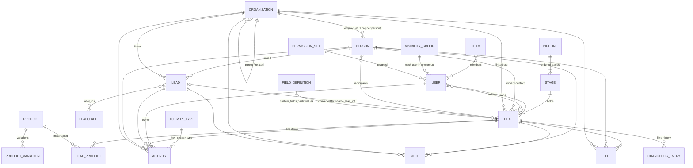

# Pipedrive CRM — как устроен (референс для своей CRM)

- **Дата исследования:** 2026-11-03
- **Источники:** только первичные. Это база знаний Pipedrive (support.pipedrive.com), документация для разработчиков (pipedrive.readme.io, developers.pipedrive.com, официальные OpenAPI-спецификации v1 и v2), официальный сайт pipedrive.com и GitHub-организация `pipedrive`. Блог pipedrive.com — это официальный, но маркетинговый источник; где он используется, это помечено.
- **Пометки в тексте:** «**не проверено**» — факт не удалось подтвердить первичным источником. «**расхождение**» — первичные источники противоречат друг другу.
- Раздел 12 — **мой синтез**, а не факты из источников.

## TL;DR

- Pipedrive — CRM для малого и среднего бизнеса, построенная вокруг визуальной воронки сделок (kanban). Сам Pipedrive говорит, что первым применил kanban-воронку в CRM ([About](https://www.pipedrive.com/en/about)). Интерфейс устроен по принципу «activity-based selling»: у каждой сделки должно быть запланировано следующее действие ([KB: follow-up pop-up](https://support.pipedrive.com/en/article/how-can-i-disable-the-follow-up-activity-pop-up)).
- Ядро модели данных: `Deal` (сделка) всегда стоит в `Stage` (этапе) одного `Pipeline` (воронки). Сделка связана с `Person` и/или `Organization`. К сделке привязаны `Activity`, `Note`, `File`, `Product`. `Lead` — неквалифицированная «пред-сделка» в отдельном Leads Inbox; у лидов та же схема полей, что у сделок ([OpenAPI v1](https://developers.pipedrive.com/docs/api/v1/openapi.yaml)).
- Пользовательские поля (custom fields) в API — ключи-хэши из 40 символов, разные в каждом аккаунте. Типов полей 16. В API v2 они вынесены во вложенный объект `custom_fields` ([Custom fields](https://pipedrive.readme.io/docs/core-api-concepts-custom-fields), [v2 migration](https://pipedrive.readme.io/docs/pipedrive-api-v2-migration-guide)).
- Механика воронки: вероятность задаётся на уровне этапа или сделки, взвешенная сумма = value × probability. «Гниение» (rotting) настраивается на каждом этапе в днях. Статусы сделки: `open` / `won` / `lost`, у проигранной есть lost reason. У каждой сделки есть Changelog — история изменений полей.
- Права доступа разделены на две оси: **permission sets** отвечают за то, что пользователь может делать, **visibility groups** — за то, что он видит. У каждой записи есть owner и поле `visible_to`.
- API: REST, v1 и v2. v2 — курсорная пагинация, `PATCH`, даты RFC 3339, примерно в 2 раза дешевле по токенам. Часть endpoint-ов v1 с 2026-08-01 больше не поддерживается. Лимиты — дневной бюджет токенов плюс burst-лимит на окно в 2 секунды. Есть webhooks v2 (`create`/`change`/`delete`, payload `meta`/`data`/`previous`) и OAuth 2.0 для Marketplace.
- Тарифы с 2025 года: Lite / Growth / Premium / Ultimate, от $14 до $79 за место в месяц при оплате за год. Автоматизации, sequences, email sync и forecast view начинаются с Growth. Кастомные права и группы видимости, обязательные поля и формулы — с Premium.
- Совет для MVP (синтез): воронка сделок + контакты/компании + активности с концепцией «следующего действия» + заметки + custom fields + история изменений + простые права «владелец / все».

## Содержание

1. [Что такое Pipedrive](#1-что-такое-pipedrive)
2. [Модель данных](#2-модель-данных)
3. [Механика воронки](#3-механика-воронки)
4. [Leads vs Deals](#4-leads-vs-deals)
5. [Activities](#5-activities)
6. [UI/UX: представления](#6-uiux-представления)
7. [Автоматизация и продуктивность](#7-автоматизация-и-продуктивность)
8. [Отчётность: Insights и прогноз](#8-отчётность-insights-и-прогноз)
9. [Права и видимость](#9-права-и-видимость)
10. [API и интеграции](#10-api-и-интеграции)
11. [Тарифы и распределение функций](#11-тарифы-и-распределение-функций)
12. [Что взять для своей CRM (синтез)](#12-что-взять-для-своей-crm-синтез)
13. [Пробелы и непроверенное](#13-пробелы-и-непроверенное)

---

## 1. Что такое Pipedrive

- **Позиционирование.** «The easy and effective CRM for small and medium-sized companies». Основан в 2010 году в Эстонии продавцами («a CRM by and for salespeople»). Им пользуются более 100 000 компаний. Pipedrive заявляет, что первым применил kanban-воронку в CRM ([About](https://www.pipedrive.com/en/about)).
- **Философия: activity-based selling.** Продавец не управляет результатом (купит клиент или нет), но управляет своими действиями: звонками, встречами, письмами. Поэтому продукт подталкивает планировать следующее действие ([официальный блог, маркетинговый источник](https://www.pipedrive.com/en/blog/activity-based-selling)). В самом продукте это видно так: после отметки активности выполненной появляется предложение запланировать следующую — «because of Pipedrive's activity-based selling design» ([KB](https://support.pipedrive.com/en/article/how-can-i-disable-the-follow-up-activity-pop-up)). Сделки на доске по умолчанию сортируются по дате следующей активности ([KB](https://support.pipedrive.com/en/article/how-are-deals-ordered-in-the-pipeline-view)).
- **Сделка в центре модели.** Сделка — это продолжающийся разговор с людьми и организациями, который отслеживается в воронке. Лиды, контакты, активности, почта и товары связаны со сделкой ([KB: data organization](https://support.pipedrive.com/en/article/how-is-pipedrive-data-organized)).

## 2. Модель данных

### 2.1 Сущности

| Сущность | Суть и ключевые поля | Источник |
|---|---|---|
| **Deal** | «Ongoing, lost or won sales to an organization or to a person. Each deal has a monetary value and must be placed in a stage». Сделку можно отдать владельцу (owner) и на неё могут подписаться несколько пользователей (followers). Поля в v2: `title`, `value`, `currency`, `status` (`open`/`won`/`lost`), `probability`, `expected_close_date`, `pipeline_id`, `stage_id`, `owner_id`, `person_id`, `org_id`, `label_ids`, `lost_reason`, `visible_to`, `won_time`, `lost_time`, `close_time`, `stage_change_time`, `add_time`, `update_time`, `is_archived`, `is_deleted`, `origin`, `channel`, `source_lead_id`, `mrr`/`arr`/`acv`, `custom_fields` | [OpenAPI v1](https://developers.pipedrive.com/docs/api/v1/openapi.yaml), [OpenAPI v2](https://developers.pipedrive.com/docs/api/v1/openapi-v2.yaml), [Deals API](https://developers.pipedrive.com/docs/api/v1/Deals) |
| **Deal (только в v1)** | Вычисляемые поля `weighted_value` («Probability times deal value…»), `rotten_time`, `next_activity_date`/`next_activity_id`, `last_activity_date`, `stage_order_nr`, `formatted_value`. В v2 их убрали | [OpenAPI v1](https://developers.pipedrive.com/docs/api/v1/openapi.yaml), [v2 migration](https://pipedrive.readme.io/docs/pipedrive-api-v2-migration-guide) |
| **Lead** | Хранится в Leads Inbox, пока его не архивируют или не превратят в сделку. Обязательны `title` и связь с person и/или organization. Может содержать большинство полей сделки (`value` в виде `{amount, currency}`, `expected_close_date`). `id` — UUID. Есть `label_ids`, `is_archived`, `was_seen`, `source_name`, `origin`, `channel`. Отдельной схемы custom fields у лидов нет: «they inherit the custom fields' structure from deals» | [Leads API](https://developers.pipedrive.com/docs/api/v1/Leads), [OpenAPI v1](https://developers.pipedrive.com/docs/api/v1/openapi.yaml) |
| **Person** | Контакт, с которым ведутся сделки. Принадлежит максимум одной организации («Each person can belong to an organization»). Поля: `name`, `first_name`, `last_name`, `emails[]` и `phones[]` (каждый элемент — `{value, primary, label}`), `org_id`, `owner_id`, `visible_to`, `label_ids`, `marketing_status`. Нельзя путать с User | [Persons API](https://developers.pipedrive.com/docs/api/v1/Persons), [OpenAPI v1](https://developers.pipedrive.com/docs/api/v1/openapi.yaml) |
| **Organization** | Компания. Поля: `name`, `owner_id`, `address` (составное: `country`, `locality`, `route`, `postal_code` и др.), `visible_to`, `label_ids`. Связи между организациями хранятся в `OrganizationRelationships` с `type` = `parent` или `related` | [Organizations API](https://developers.pipedrive.com/docs/api/v1/Organizations), [OpenAPI v1](https://developers.pipedrive.com/docs/api/v1/openapi.yaml) |
| **Activity** | «Appointments/tasks/events on a calendar», связываются с deal, lead, person, organization (и project). Поля: `subject`, `type`, `due_date`, `due_time`, `duration`, `done`, `busy`, `owner_id`, `participants`, `attendees`, `location`, `note`, `public_description`, `priority`. Активность можно создать без даты | [Activities API](https://developers.pipedrive.com/docs/api/v1/Activities), [OpenAPI v1](https://developers.pipedrive.com/docs/api/v1/openapi.yaml) |
| **ActivityType** | Справочник типов: имя + иконка. Связь с активностью идёт по строке: `ActivityType.key_string = Activity.type` | [OpenAPI v1](https://developers.pipedrive.com/docs/api/v1/openapi.yaml) |
| **CallLog** | Результат звонка от интегрированного телефонного провайдера. Считается разновидностью активности | [OpenAPI v1](https://developers.pipedrive.com/docs/api/v1/openapi.yaml) |
| **Note** | HTML-текст, прикрепляется к deal, person, organization (и lead). Показывается в ленте от новых к старым. До ~100 000 символов. Заметку можно закрепить (флаги `pinned_to_*_flag`) | [OpenAPI v1](https://developers.pipedrive.com/docs/api/v1/openapi.yaml) |
| **File** | Прикрепляется к deal, person, organization, product, note или activity. Также бывают «remote files» — ссылки на внешнее хранилище | [OpenAPI v1](https://developers.pipedrive.com/docs/api/v1/openapi.yaml) |
| **Product** | Каталог товаров и услуг. У товара может быть N цен в разных валютах и N вариаций (variations), но не больше одной цены на пару «вариация × валюта». Товары добавляются в сделку как deal products: количество, цена, скидка, налог, `billing_frequency` (`one-time`, `monthly`, `quarterly`, `semi-annually`, `annually`). Если к сделке привязаны товары, её стоимость считается автоматически | [OpenAPI v1](https://developers.pipedrive.com/docs/api/v1/openapi.yaml), [OpenAPI v2](https://developers.pipedrive.com/docs/api/v1/openapi-v2.yaml), [KB Products](https://support.pipedrive.com/en/article/products) |
| **Pipeline / Stage** | «Pipelines are essentially ordered collections of stages». Stage — «a bucket that can hold a number of deals» с порядковым номером внутри воронки. Настройки этапа: вероятность, rotting (`is_deal_rot_enabled`, `days_to_rotten`). Настройка воронки: включена ли вероятность на уровне сделки (`is_deal_probability_enabled`) | [OpenAPI v1](https://developers.pipedrive.com/docs/api/v1/openapi.yaml), [v2 migration](https://pipedrive.readme.io/docs/pipedrive-api-v2-migration-guide) |
| **User / Team** | User — сотрудник с доступом к аккаунту (один человек может состоять в нескольких аккаунтах). Teams — группы пользователей; в API v1 это теперь `LegacyTeams`. Лимит команд на Premium — 15, на Ultimate — 25 | [OpenAPI v1](https://developers.pipedrive.com/docs/api/v1/openapi.yaml), [KB Usage limits](https://support.pipedrive.com/en/article/usage-limits-in-pipedrive) |
| **Filter** | Сохранённый набор условий для deals, leads, persons, organizations и products. Не больше 16 условий. В API структура такая: верхний уровень — группа `AND`, внутри две группы — `AND` и `OR` | [OpenAPI v1](https://developers.pipedrive.com/docs/api/v1/openapi.yaml) |
| **Label / LeadLabel** | Цветные метки. Для лидов есть три метки по умолчанию: hot, cold, warm | [OpenAPI v1](https://developers.pipedrive.com/docs/api/v1/openapi.yaml) |
| **Goal** | Цели трёх уровней: company, team, user | [OpenAPI v1](https://developers.pipedrive.com/docs/api/v1/openapi.yaml) |
| **Currency** | Коды ISO-4217 и пользовательские валюты (`is_custom_flag`) | [OpenAPI v1](https://developers.pipedrive.com/docs/api/v1/openapi.yaml) |
| **Project** (доп. модуль) | Работа после продажи: Project → Board → Phase, плюс Tasks. Проект привязывается к сделкам, person, organization | [OpenAPI v1](https://developers.pipedrive.com/docs/api/v1/openapi.yaml) |

**Связи** — сводная таблица из базы знаний ([KB: data organization](https://support.pipedrive.com/en/article/how-is-pipedrive-data-organized)): Deal ↔ people, organizations, activities, mail, products. Person ↔ leads, deals, activities, mail. Organization ↔ leads, deals, activities, mail. Products связаны только со сделками.

Кроме основного person, у сделки могут быть дополнительные **participants** (другие persons) и **followers** (пользователи, подписанные на сделку). Для этого есть endpoint-ы `/deals/{id}/participants` и `/deals/{id}/followers` ([Deals API](https://developers.pipedrive.com/docs/api/v1/Deals)).

### 2.2 Custom fields

- Создаются для lead/deal, person, organization, product и project. У лидов те же поля, что у сделок: если создать поле для сделок, такое же появится и у лидов ([KB Custom fields](https://support.pipedrive.com/en/article/custom-fields)). Схема полей для активностей настраивается отдельно ([KB Activity fields](https://support.pipedrive.com/en/article/activities-customization)).
- **Ключи в API** — случайные хэши из 40 символов (например, `dcf558aac1ae4e8c4f849ba5e668430d8df9be12`). Они уникальны для каждого аккаунта. Схему полей отдают endpoint-ы `/dealFields`, `/personFields`, `/organizationFields`, `/productFields` ([Custom fields](https://pipedrive.readme.io/docs/core-api-concepts-custom-fields)).
- **Типы `field_type` (16 штук):** `varchar` (до 255 символов), `varchar_auto` (с автодополнением), `text` (без ограничения длины), `double`, `monetary`, `enum` (один вариант), `set` (несколько вариантов; до 10 000 опций у обоих), `user`, `org`, `people`, `phone`, `time`, `timerange`, `date`, `daterange`, `address` ([Custom fields](https://pipedrive.readme.io/docs/core-api-concepts-custom-fields)).
- **Составные типы в v1** хранятся в нескольких «соседних» ключах. Например, у `monetary` валюта лежит в `<hash>_currency`, у `address` — в отдельных подполях. **В v2** все custom fields собраны во вложенный объект `custom_fields`, а составные типы стали вложенными объектами. Признак пользовательского поля в схеме: `edit_flag` в v1, `is_custom_field` в v2 ([Custom fields](https://pipedrive.readme.io/docs/core-api-concepts-custom-fields), [v2 migration](https://pipedrive.readme.io/docs/pipedrive-api-v2-migration-guide)).
- **Качество данных:** поле можно сделать «required» (без него нельзя сохранить) или «important» (пустое поле подсвечивается, но сохранить можно). Есть поля, видимые только в отдельных воронках (pipeline-specific fields), и формульные поля из числовых и денежных значений сделки — обе функции на Premium и выше ([KB Custom fields](https://support.pipedrive.com/en/article/custom-fields), [KB Plans](https://support.pipedrive.com/en/article/what-features-do-the-pipedrive-plans-have)).
- **Лимит количества полей:** Lite — 30, Growth — 100, Premium — 300, Ultimate — 500 ([KB Usage limits](https://support.pipedrive.com/en/article/usage-limits-in-pipedrive)).

### 2.3 ER-схема (упрощённая)

## 3. Механика воронки

- **Несколько воронок.** Их рекомендуют заводить, когда процессы продажи различаются по структуре: разные продукты или разные наборы полей. Не рекомендуют делить воронки по региону, по продавцу или для работы после продажи — для этого есть поля, фильтры и Projects. Воронку можно создать с нуля или скопировать. Все воронки сразу на одной доске показать нельзя, даже если у них одинаковые этапы ([KB Multiple pipelines](https://support.pipedrive.com/en/article/how-can-i-have-multiple-pipelines)).
- **Этапы.** Этап можно добавить между существующими, переименовать или удалить. **Удаление этапа удаляет и его сделки**, поэтому их нужно сначала перенести ([KB Pipeline design](https://support.pipedrive.com/en/article/how-can-i-customize-my-pipeline-stages)).
- **Вероятность и взвешенная сумма.** Вероятность этапа по умолчанию 100%. Вероятность сделки всегда важнее вероятности этапа. Формулы ([KB Probability](https://support.pipedrive.com/en/article/probability-in-pipedrive)):
  - задана вероятность сделки → `weighted = value × deal_probability / 100`;
  - задана только вероятность этапа → `weighted = value × stage_probability / 100`;
  - не задано ничего → `weighted = value`.
  На доске видны обычная и взвешенная сумма по каждому этапу и по воронке целиком (там же). В API v1 это поле `weighted_value`, в v2 его убрали ([v2 migration](https://pipedrive.readme.io/docs/pipedrive-api-v2-migration-guide)).
- **Rotting («гниение»).** Включается на каждом этапе отдельно: «Rotting in (days)». Если сделку не обновляли дольше этого срока, её карточка становится красной. Счётчик сбрасывают: отметка активности выполненной, добавление заметки или файла, отправка или получение письма, изменение полей сделки. **Запланированная в будущем активность гниение не останавливает** ([KB Rotting](https://support.pipedrive.com/en/article/the-rotting-feature)). В v1 есть поле `rotten_time` («The date and time of changing the deal status as rotten») ([OpenAPI v1](https://developers.pipedrive.com/docs/api/v1/openapi.yaml)).
- **Won/Lost.** Внизу доски есть зоны, куда перетаскивают карточку: Won, Lost, Delete. Закрытые сделки пропадают с активной доски ([KB Pipeline view](https://support.pipedrive.com/en/article/pipeline-view)). Причина проигрыша бывает свободным текстом или выбором из заранее заданного списка; список ведёт пользователь с правами Deals admin ([KB Lost reasons](https://support.pipedrive.com/en/article/lost-reasons)). Переоткрыть закрытую сделку можно кнопкой Restore/Reopen в карточке — **не проверено** (это видно только в выдаче поиска, страница базы знаний этого не подтвердила).
- **Перемещение сделок** между этапами — перетаскиванием на доске ([KB Pipeline view](https://support.pipedrive.com/en/article/pipeline-view)). Как переносить сделку между воронками в UI, проверенная статья не описывает (**не проверено**). В API это изменение `pipeline_id`/`stage_id` в PATCH `/api/v2/deals/{id}` ([Deals API](https://developers.pipedrive.com/docs/api/v1/Deals)).
- **Время в этапах.** В шапке карточки сделки есть полоса этапов: она показывает текущий этап и сколько дней сделка провела в каждом ([KB Deal detail view](https://support.pipedrive.com/en/article/deal-detail-view)). В API есть `stage_change_time` ([OpenAPI v2](https://developers.pipedrive.com/docs/api/v1/openapi-v2.yaml)).
- **История.** В блоке History карточки собраны заметки, активности, письма, файлы, документы и счета, с фильтром по типу. Отдельная вкладка **Changelog** хранит изменения полей с датами ([KB Deal detail view](https://support.pipedrive.com/en/article/deal-detail-view)): этап, сумма, метка, контакт, ожидаемая дата закрытия, стандартные и пользовательские поля ([KB Detail view](https://support.pipedrive.com/en/article/detail-view); список полей взят из выдачи поиска). В API: `GET /api/v1/deals/{id}/flow` (лента обновлений, «Lists updates about a deal», 40 токенов) и `GET /api/v1/deals/{id}/changelog` ([Deals API](https://developers.pipedrive.com/docs/api/v1/Deals), [OpenAPI v1](https://developers.pipedrive.com/docs/api/v1/openapi.yaml)).
- **Архив и удаление.** Архив убирает неактивные сделки и лиды из рабочего списка без потери истории и помогает не превысить лимит записей. Архивировать можно автоматизацией, например «won/lost без обновлений 90 дней». Обычные list-endpoint-ы архивные записи не возвращают, для них есть отдельные endpoint-ы ([KB Archive](https://support.pipedrive.com/en/article/archive-deals-leads)). Удаление мягкое: «After 30 days, the deal will be permanently deleted» ([OpenAPI v2](https://developers.pipedrive.com/docs/api/v1/openapi-v2.yaml)).

## 4. Leads vs Deals

- **Lead** — «potential sales opportunity… that has yet to be qualified». **Deal** — «qualified sales opportunity… you're actively working on» ([KB Leads vs deals](https://support.pipedrive.com/en/article/leads-vs-deals)).
- **Жизненный цикл лида.** Лид попадает в Leads Inbox → его квалифицируют (метки, поля) → дальше один из трёх исходов: Convert to deal, Archive или Delete. Удалённый лид можно восстановить в течение 30 дней (там же).
- **Конвертация.** В диалоге выбирают воронку, видимость и сумму сделки. В сделку переносятся person/organization, заметки, упоминания, комментарии, активности ([KB Leads vs deals](https://support.pipedrive.com/en/article/leads-vs-deals)), а также файлы ([KB Leads Inbox](https://support.pipedrive.com/en/article/leads-inbox)). Метки можно скопировать по желанию — **не проверено** (видно только в выдаче поиска). Обратная операция «сделка → лид» тоже есть. В API v2 конвертация асинхронная: `POST /leads/{id}/convert/deal` возвращает id фоновой задачи, её статус смотрят через `/leads/{id}/convert/status/{conversion_id}`; обратно — `POST /deals/{id}/convert/lead` ([OpenAPI v2](https://developers.pipedrive.com/docs/api/v1/openapi-v2.yaml), [Leads API](https://developers.pipedrive.com/docs/api/v1/Leads)). У сделки есть `source_lead_id` — ссылка на лид, из которого она получилась ([OpenAPI v2](https://developers.pipedrive.com/docs/api/v1/openapi-v2.yaml)).
- **Метки.** Цветные; по умолчанию hot, cold, warm, можно добавлять свои ([OpenAPI v1](https://developers.pipedrive.com/docs/api/v1/openapi.yaml)).
- **Источники (Lead sources).** Фиксированный список, редактировать нельзя: `Manually created`, `Deal`, `Web forms`, `Prospector`, `Leadbooster` (сюда же попадает Chatbot), `Live chat`, `Import`, `Website visitors`, `Workflow automation`, `API` ([OpenAPI v1](https://developers.pipedrive.com/docs/api/v1/openapi.yaml)). Кроме того, у лида и сделки есть поля `origin`, `channel`, `channel_id` — канал можно задать вручную ([OpenAPI v2](https://developers.pipedrive.com/docs/api/v1/openapi-v2.yaml)).
- **Лимит.** Лиды и сделки считаются вместе: «Leads and deals» = 2 500 / 5 000 / 15 000 / 20 000 × число мест, но не больше 300 000 ([KB Usage limits](https://support.pipedrive.com/en/article/usage-limits-in-pipedrive)).

## 5. Activities

- **Типы.** По умолчанию: call, meeting, task, deadline, email, lunch. Можно добавлять свои ([KB Activities](https://support.pipedrive.com/en/article/activities)).
- **Планирование.** У активности есть название, тип, дата, время, длительность, владелец, связь с deal/lead/person/organization, гости, место и флаг Busy/Free. Связи подставляются автоматически: активность сделки привязывается к её контакту и организации, активность person — к его организации. У выполненной активности сохраняются обе даты: `due_date` (когда планировали) и время отметки «выполнено» (там же).
- **«Следующая активность» и просрочка.** На карточке сделки есть индикатор ([KB Prioritize deals](https://support.pipedrive.com/en/article/how-are-deals-ordered-in-the-pipeline-view)):

  | Индикатор | Значение | Приоритет |
  |---|---|---|
  | красная стрелка | есть просроченная активность | very high |
  | зелёная стрелка | активность на сегодня | high |
  | жёлтое предупреждение | активностей нет | medium |
  | серая стрелка | только будущие активности | low |

  Внутри этапа сделки по умолчанию отсортированы по дате следующей активности. В v1 у сделки есть поля `next_activity_date`/`next_activity_id` ([OpenAPI v1](https://developers.pipedrive.com/docs/api/v1/openapi.yaml)).
- **Предложение следующего шага.** После «done» Pipedrive сразу предлагает запланировать следующую активность. Администратор может отключить это предложение или оставить его только для отдельных воронок ([KB](https://support.pipedrive.com/en/article/how-can-i-disable-the-follow-up-activity-pop-up)).
- **Синхронизация календаря.** Поддерживаются Google и Microsoft (Exchange, Outlook, Office 365). Синхронизация бывает односторонней (Pipedrive → календарь) или двусторонней. Из внешнего календаря в Pipedrive попадают только будущие события. Пользователь выбирает, какие типы активностей синхронизировать, и настраивает приватность событий ([KB Calendar sync](https://support.pipedrive.com/en/article/calendar-sync)).
- **Представления.** Список активностей и календарь ([KB Activities](https://support.pipedrive.com/en/article/activities)).

## 6. UI/UX: представления

- **Pipeline (kanban).** На карточке: название, контакт, сумма, метка, владелец, индикатор активности. Набор полей на карточке настраивается. Карточки перетаскиваются между этапами, внизу — зоны Won / Lost / Delete. Сортировка: по умолчанию по следующей активности, также по сумме, ожидаемой дате закрытия, владельцу. Фильтры: Filter → Filters ([KB Pipeline view](https://support.pipedrive.com/en/article/pipeline-view)).
- **List view.** Табличный вид для leads, deals, contacts, activities, projects, products. Есть массовое редактирование через панель bulk edit. Фильтры привязаны к типу записей: фильтр сделок нельзя применить к контактам ([KB List view](https://support.pipedrive.com/en/article/bulk-editing-and-filtering)). Фильтр можно добавить в избранное звёздочкой ([KB Favorite filters](https://support.pipedrive.com/en/article/how-can-i-favorite-filters)). **Расхождение:** выдача поиска по базе знаний говорит о «up to ten» условиях в UI, а API-спецификация — о максимуме 16 условий на фильтр ([OpenAPI v1](https://developers.pipedrive.com/docs/api/v1/openapi.yaml)).
- **Forecast view.** Kanban по периодам: сделки раскладываются по колонкам на основе ожидаемой даты закрытия. В шапке колонки: сумма открытых сделок, сумма выигранных и прогноз. Для выигранных сделок берётся фактическая дата выигрыша. Учитываются взвешенные суммы. Перетаскивание карточки между колонками меняет дату закрытия. Настройки «Show by» и «Arrange by» ([KB Forecast view](https://support.pipedrive.com/en/article/the-forecast-view-revenue-projection)). **Расхождение по тарифу:** в статье о forecast view написано «Professional and higher» (старые тарифы), а в актуальной таблице тарифов — Growth и выше ([KB Plans](https://support.pipedrive.com/en/article/what-features-do-the-pipedrive-plans-have)).
- **Карточка записи (detail view).** Шапка с полосой этапов. Слева sidebar из настраиваемых блоков: Summary (deal score, сумма и товары, метрики выручки, метка, вероятность, дата закрытия, контакт, организация), дальше детали и связанные записи. Справа: **Focus** (запланированные активности, черновики писем, закреплённые заметки) и **History** (лента всего, что было по сделке, с фильтрами, плюс вкладка Changelog) ([KB Deal detail view](https://support.pipedrive.com/en/article/deal-detail-view)).
- **Поиск и Quick add.** Глобальный поиск по deals, leads, contacts, activities, projects, products и вложениям, с фильтром по типу. Рядом кнопка Quick add (deal, activity, contact, product). Горячие клавиши: `/` — поиск, `.` или `+` — quick add ([KB Interface](https://support.pipedrive.com/en/article/quick-actions-in-pipedrive); данные из выдачи поиска, сама страница не открывалась — **частично не проверено**).

## 7. Автоматизация и продуктивность (кратко)

- **Workflow automations** ([KB](https://support.pipedrive.com/en/article/workflow-automation)). Логика «если → то».
  - Триггеры по событию: сущности deal, person, activity, lead, organization, project; события added, updated, deleted.
  - Триггеры по дате: deal, person, activity, organization; варианты «exact date», «before date», «after date».
  - Условия, шаги «ждать условия», задержки, ветвление if/else.
  - Действия над person, organization, lead, deal, activity, email, notes, campaigns, projects, webhooks, плюс Slack, MS Teams, Trello, Asana. Действия выполняются по порядку сверху вниз.
  - Лимиты: активных автоматизаций 50 / 150 / 250, веток if/else 3 / 10 / 20 (Growth / Premium / Ultimate) ([KB Usage limits](https://support.pipedrive.com/en/article/usage-limits-in-pipedrive)).
- **Sequences.** Повторяемые цепочки для сделок и лидов: письма (в том числе черновики для ручной отправки) и задачи. До 15 шагов, до 500 записей в одной цепочке. Доступны с Growth ([KB Sequences](https://support.pipedrive.com/en/article/sequences)). Количество цепочек: 5 / 25 / 50 ([KB Usage limits](https://support.pipedrive.com/en/article/usage-limits-in-pipedrive)).
- **Email.** Синхронизация с Gmail, Office 365/Outlook, Exchange, IMAP. Письма привязываются к сделкам, лидам, проектам автоматически или вручную. Есть шаблоны, отслеживание открытий, подписи ([KB Email sync](https://support.pipedrive.com/en/article/email-sync); данные из выдачи поиска). Альтернатива — Smart BCC: письмо отправляется со скрытой копией на специальный адрес и так попадает в Pipedrive. Активное двустороннее подключение почты — одно на пользователя ([OpenAPI v1, Mailbox](https://developers.pipedrive.com/docs/api/v1/openapi.yaml)).
- **LeadBooster** (входит в Premium и выше, на младших тарифах — платный модуль): Chatbot, Live Chat, Web Forms, Prospector. Prospector — база «400 million profiles and 10 million companies» ([KB LeadBooster](https://support.pipedrive.com/en/article/leadbooster-add-on); данные из выдачи поиска). Web Forms — встраиваемые формы, заявки из них становятся лидами или сделками; есть reCAPTCHA и поле для вложений ([KB Web Forms](https://support.pipedrive.com/en/article/web-forms)).
- **Meeting scheduler.** Ссылки для записи на встречу: общая доступность или конкретные слоты. Доступен с Growth; на Growth активна одна ссылка общей доступности ([KB Scheduler](https://support.pipedrive.com/en/article/scheduler); данные из выдачи поиска).
- **AI** ([KB Pipedrive AI](https://support.pipedrive.com/en/article/pipedrive-ai)):
  - на всех тарифах: помощник импорта, создание отчётов по текстовому запросу, Sales Assistant (beta — отвечает на вопросы по данным), сканер визиток;
  - Premium и выше: генерация писем, AI-уведомления, саммари переписки (beta), варианты ответов (beta).
  - Отдельно: лента Pulse на Lite ([Newsroom, 2025-07-15](https://www.pipedrive.com/en/newsroom/pipedrive-launches-smart-prospecting-toolkit-pulse-and-revamps-plans-to-help-businesses-focus-prioritize-and-grow)) и custom deal scoring на Premium ([KB Plans](https://support.pipedrive.com/en/article/what-features-do-the-pipedrive-plans-have)).

## 8. Отчётность: Insights и прогноз

- **Отчёты Insights.** Activity (результативность, письма), Campaign, Contact, Lead (результативность, конверсия), Deal (результативность, конверсия, длительность, продвижение, товары), Revenue forecast, Project ([KB Insights](https://support.pipedrive.com/en/article/insights-feature)). Фильтровать можно по стандартным и пользовательским полям; отчёты по custom fields доступны с Premium ([KB Plans](https://support.pipedrive.com/en/article/what-features-do-the-pipedrive-plans-have)). Количество отчётов на пользователя: 15 / 50 / 250 / 500 ([KB Usage limits](https://support.pipedrive.com/en/article/usage-limits-in-pipedrive)).
- **Дашборды.** Собирают отчёты и цели на одном экране. Ими можно делиться с коллегами или открыть внешнюю ссылку только для просмотра. Больше одного дашборда — с Premium ([KB Insights](https://support.pipedrive.com/en/article/insights-feature)).
- **Цели (Goals).** Сущности: Deal (количество или сумма добавленных, продвинутых, выигранных), Activity (добавленных или выполненных), Forecast. Уровни: пользователь, команда, компания. Цель считается за выбранный период (там же). Цели для команд — с Premium ([KB Plans](https://support.pipedrive.com/en/article/what-features-do-the-pipedrive-plans-have)).
- **Прогноз** — это forecast view (раздел 6) и отчёт Revenue forecast. Основан на `expected_close_date` и взвешенной сумме ([KB Forecast view](https://support.pipedrive.com/en/article/the-forecast-view-revenue-projection), [KB Probability](https://support.pipedrive.com/en/article/probability-in-pipedrive)).

## 9. Права и видимость

- **Две оси.** «Visibility groups – define what users can see», «Permission sets – define what users can do» ([KB Overview](https://support.pipedrive.com/en/article/visibility-and-permissions-overview), [KB Permission sets](https://support.pipedrive.com/en/article/permission-sets)).
- **Permission sets.** Задаются отдельно для каждого «приложения»: Deals app, Projects app, Campaigns app, Global permissions, Account settings. Админский набор нельзя изменить — в нём все права. Обычный набор редактируется. Примеры прав: «Delete deals», «Edit deals won/lost date», «Merge duplicate leads», «Export data from list views», «See other users' data». Свои наборы: Premium — 15, Ultimate — 25 ([KB Permission sets](https://support.pipedrive.com/en/article/permission-sets)).
- **Роли администратора.** Deals admin видит все сделки и лиды независимо от видимости. Global admin видит все записи и по умолчанию только он создаёт автоматизации ([KB Types of users](https://support.pipedrive.com/en/article/types-of-users-in-pipedrive), [KB Who can create automations](https://support.pipedrive.com/en/article/who-can-create-workflows-in-pipedrive); данные из выдачи поиска).
- **Visibility groups.** На Lite и Growth есть одна общая группа. На Premium и Ultimate можно создавать свои группы и подгруппы (до 15 и 25). Каждый пользователь состоит ровно в одной группе ([KB Visibility groups](https://support.pipedrive.com/en/article/visibility-groups), [KB Overview](https://support.pipedrive.com/en/article/visibility-and-permissions-overview)).
- **Поле `visible_to` у записи** ([OpenAPI v1](https://developers.pipedrive.com/docs/api/v1/openapi.yaml)):

  | Тарифы | Значения |
  |---|---|
  | Lite / Growth | `1` — owner & followers, `3` — entire company |
  | Premium / Ultimate | `1` — owner only, `3` — owner's visibility group, `5` — owner's visibility group and sub-groups, `7` — entire company |

  Если `visible_to` не передать, берётся значение по умолчанию для этого типа записей у текущего пользователя.
- **Владение записью.** Владелец всегда видит и редактирует свою запись. Владельца можно сменить в карточке или в списке. Владельцу засчитываются выигранные и проигранные сделки. Пользователь без доступа может попросить добавить его в followers ([KB Overview](https://support.pipedrive.com/en/article/visibility-and-permissions-overview)).
- **Безопасность.** SSO и 2FA есть на всех тарифах. Security alerts и security rules — только на Ultimate ([KB Plans](https://support.pipedrive.com/en/article/what-features-do-the-pipedrive-plans-have)).

## 10. API и интеграции

- **Базовые URL.** `https://api.pipedrive.com/v1` и `https://api.pipedrive.com/api/v2` ([OpenAPI v1](https://developers.pipedrive.com/docs/api/v1/openapi.yaml), [OpenAPI v2](https://developers.pipedrive.com/docs/api/v1/openapi-v2.yaml)).
- **v1 и v2.** В v2 есть Activities, Deals (с товарами, followers, рассрочками), Organizations, Persons, Products, Fields, Pipelines, Stages, Search, Leads, Projects, Users ([API v2](https://pipedrive.readme.io/docs/pipedrive-api-v2), [OpenAPI v2](https://developers.pipedrive.com/docs/api/v1/openapi-v2.yaml)). Что изменилось ([v2 migration](https://pipedrive.readme.io/docs/pipedrive-api-v2-migration-guide)):
  - пользовательские поля вынесены в объект `custom_fields`;
  - все даты в RFC 3339;
  - курсорная пагинация вместо offset;
  - булевы значения — `true`/`false` вместо `1`/`0`;
  - `PUT` заменён на `PATCH`;
  - связанные объекты больше не вкладываются в ответ;
  - поля переименованы (`user_id` → `owner_id`, `active_flag` → `is_deleted`, `rotten_days` → `days_to_rotten`, …);
  - убраны вычисляемые поля (`weighted_value`, `next_activity_*`, `formatted_*`);
  - добавлены параметры `include_fields` и `custom_fields` для выбора полей в ответе.
- **Сроки отказа от v1.** О выводе части endpoint-ов v1 объявили 2025-04-14 ([changelog](https://developers.pipedrive.com/changelog/post/deprecation-of-selected-api-v1-endpoints)). С 2026-08-01 эти endpoint-ы (Activities, Deals, Persons, Organizations, Products, Pipelines, Stages, Search) «out-of-support»: могут ещё отвечать, но поддержки и гарантий нет ([changelog](https://developers.pipedrive.com/changelog/post/deprecated-apiv1-endpoints-become-out-of-support)). Остальные endpoint-ы v1 (Notes, Files, Filters, Webhooks, flow, changelog и др.) пока живут только в v1.
- **Аутентификация.**
  - API token в заголовке `x-api-token` ([OpenAPI v1](https://developers.pipedrive.com/docs/api/v1/openapi.yaml)).
  - OAuth 2.0 через `https://oauth.pipedrive.com/oauth/authorize` и `/oauth/token`, grant types `authorization_code` и `refresh_token`. Access token живёт 60 минут. Refresh token истекает, если не использовать его 60 дней; каждое использование продлевает срок. В ответе приходит `api_domain` компании. Запросы ограничены выданными scopes ([OAuth](https://pipedrive.readme.io/docs/marketplace-oauth-authorization)).
  - Для приложений в Marketplace OAuth обязателен ([About the Marketplace](https://pipedrive.readme.io/docs/about-the-marketplace)).
- **Rate limits по токенам** ([Rate limiting](https://pipedrive.readme.io/docs/core-api-concepts-rate-limiting)):
  - дневной бюджет = 30 000 × множитель тарифа (Lite 1, Growth 2, Premium 5, Ultimate 7) × число мест, плюс докупленные пакеты. Сбрасывается в полночь по часовому поясу сервера. Верхний предел — 100 млн ([KB Usage limits](https://support.pipedrive.com/en/article/usage-limits-in-pipedrive));
  - стоимость операций в общем виде: получить одну запись — 2, список — 20, обновить — 10, удалить — 6, поиск — 40. Точная стоимость каждого endpoint-а записана в поле `x-token-cost` спецификации. Например, v2 `GET /deals` стоит 10, а v1 `GET /deals/{id}/flow` — 40 ([OpenAPI v2](https://developers.pipedrive.com/docs/api/v1/openapi-v2.yaml), [OpenAPI v1](https://developers.pipedrive.com/docs/api/v1/openapi.yaml)). Endpoint-ы v2 расходуют на 50% меньше токенов ([changelog](https://developers.pipedrive.com/changelog/post/deprecated-apiv1-endpoints-become-out-of-support); данные из выдачи поиска);
  - burst-лимит на окно в 2 секунды, отдельно для каждого токена: Lite 20/80, Growth 40/160, Premium 100/400, Ultimate 120/480 (API token / OAuth). Поиск — 10 запросов на 2 секунды на любом тарифе;
  - заголовки `x-ratelimit-limit`, `x-ratelimit-remaining`, `x-ratelimit-reset`. Если бюджет исчерпан — ответ `429`; при продолжающемся злоупотреблении — `403` от Cloudflare.
- **Пагинация** ([Pagination](https://pipedrive.readme.io/docs/core-api-concepts-pagination)):
  - курсорная: параметры `cursor` и `limit` (максимум 500), в ответе `additional_data.next_cursor`. Используется во всех list-endpoint-ах v2 и в части v1;
  - offset: параметры `start` и `limit` (максимум 500), в ответе `additional_data.pagination.more_items_in_collection` и `next_start`.
- **Webhooks** ([v2 guide](https://pipedrive.readme.io/docs/guide-for-webhooks-v2), [webhooks guide](https://pipedrive.readme.io/docs/guide-for-webhooks)):
  - по умолчанию создаются webhooks v2; v1 доступны только через API как устаревший вариант;
  - события: `create`, `change`, `delete`;
  - сущности: activity, board, deal, deal_installment, deal_product, lead, note, organization, person, phase, pipeline, product, project, stage, task, user;
  - payload: `{ meta, data, previous }`. Важные поля `meta`: `action`, `entity`, `entity_id`, `company_id`, `user_id`, `timestamp`, `change_source` (`app`/`api`), `is_bulk_edit`, `correlation_id`, `attempt`, `permitted_user_ids`, `webhook_id`;
  - не больше 40 webhooks на пользователя;
  - доставка считается успешной только при ответе 2XX; таймаут 10 секунд. Повторы через 3, 30 и 150 секунд. После 10 неудачных первых попыток подряд webhook блокируется на 30 минут. Если 3 дня подряд не было ни одной успешной доставки, webhook удаляется. Поддерживается HTTP Basic auth; самоподписанные сертификаты не принимаются.
- **Marketplace.** Публичные приложения обязательно используют OAuth. Место приложения в каталоге зависит от рейтинга и числа установок ([About the Marketplace](https://pipedrive.readme.io/docs/about-the-marketplace)). Pipedrive заявляет «500+» интеграций ([Integrations](https://www.pipedrive.com/en/crm/integrations); данные из выдачи поиска).
- **App Extensions** — способы встроить UI своего приложения в Pipedrive ([App extensions](https://pipedrive.readme.io/docs/app-extensions)):
  - app actions — ссылка на внешнюю страницу или JSON-модалка;
  - JSON panels в карточке записи;
  - Custom UI на iframe: плавающее окно, панель, модалка, страница настроек;
  - Video calling и Messaging extensions.
  Для этого есть SDK [`pipedrive/app-extensions-sdk`](https://github.com/pipedrive/app-extensions-sdk).
- **Официальные клиенты и спецификации.** Клиенты [`pipedrive/client-nodejs`](https://github.com/pipedrive/client-nodejs) и [`pipedrive/client-php`](https://github.com/pipedrive/client-php), примеры [`example-apps`](https://github.com/pipedrive/example-apps), шаблон приложения [`create-pipedrive-app`](https://github.com/pipedrive/create-pipedrive-app). OpenAPI-спецификации: [v1](https://developers.pipedrive.com/docs/api/v1/openapi.yaml), [v2](https://developers.pipedrive.com/docs/api/v1/openapi-v2.yaml).

## 11. Тарифы и распределение функций

*Проверено 2026-11-03. Страница pipedrive.com/en/pricing отвечает 403 (защита Cloudflare). Поэтому цены по отдельным тарифам взяты из поисковой выдачи по этой странице. Подтверждено напрямую только на официальном сайте: «Lite to Ultimate… range from $14 to $79 per seat per month in the US, with discounts for annual payments», бесплатный trial — 14 дней ([pipedrive.com](https://www.pipedrive.com/en/crm/solutions/salesforce-alternative)).*

- **Состав тарифов.** В 2025 году тарифы переименовали и объединили: Essential → Lite, Advanced → Growth, Professional и Power → Premium, Enterprise → Ultimate ([KB New plans](https://support.pipedrive.com/en/article/new-pipedrive-plans), [Newsroom 2025-07-15](https://www.pipedrive.com/en/newsroom/pipedrive-launches-smart-prospecting-toolkit-pulse-and-revamps-plans-to-help-businesses-focus-prioritize-and-grow)). Оплата за место, даже если место никому не назначено ([KB Pricing](https://support.pipedrive.com/en/article/how-does-pricing-work-in-pipedrive)).
- **Цены при оплате за год** (по выдаче поиска для [pricing](https://www.pipedrive.com/en/pricing)): Lite $14, Growth $39, Premium $59, Ultimate $79 за место в месяц. Помесячные цены — **не проверено**.

| Функция | Lite | Growth | Premium | Ultimate |
|---|---|---|---|---|
| Воронки, контакты, активности, Insights (1 дашборд), custom fields | ✔ | ✔ | ✔ | ✔ |
| Email sync, шаблоны, трекинг; Automations; Sequences; Scheduler; Forecast view | — | ✔ | ✔ | ✔ |
| Обязательные поля, формулы, поля для отдельных воронок | — | — | ✔ | ✔ |
| Свои visibility groups и permission sets, цели и фильтры для команд | — | — | ✔ | ✔ |
| Несколько дашбордов, отчёты по custom fields, автоназначение, team inbox, custom scoring | — | — | ✔ | ✔ |
| LeadBooster, Projects, Smart Docs | платно | платно | ✔ | ✔ |
| Обогащение данных о контактах, security alerts и rules | — | — | — | ✔ |
| Телефонная поддержка | — | — | ✔ | ✔ |

Источник таблицы — [KB Plans](https://support.pipedrive.com/en/article/what-features-do-the-pipedrive-plans-have) (обновлено 2026-09-03). Числовые лимиты — [KB Usage limits](https://support.pipedrive.com/en/article/usage-limits-in-pipedrive) (обновлено 2026-10-12).

**Как читать это для своей CRM.** То, что есть уже на Lite (воронка, контакты, активности, простые поля и отчёты), Pipedrive считает ядром продукта. Автоматизация и почта — первый платный уровень. Тонкие права, качество данных (обязательные поля, формулы) и мультикомандность — продвинутый уровень.

## 12. Что взять для своей CRM (синтез)

> **Это мой синтез на основе разделов 1–11, а не факты из источников.**

**MVP: сущности**
- `Pipeline` → `Stage` (порядок, вероятность, `rot_days`) → `Deal` (`title`, `value`, `currency`, `status` open/won/lost, `stage_id`, `owner_id`, `person_id`, `org_id`, `expected_close_date`, `probability` nullable, `lost_reason`, `won_at`/`lost_at`, `stage_changed_at`).
- `Person` (несколько email и телефонов в виде массивов `{value, label, primary}`, одна организация) и `Organization`.
- `Activity` + справочник `ActivityType`. Связи с deal/person/org, `due_date` + `due_time` отдельно (активность может быть без времени), флаг `done` + `done_at`.
- `Note` (rich text, закрепление) и `File` — полиморфная связь «к какой записи прикреплено».
- `User`, а `owner_id` — у каждой бизнес-записи.
- `FieldDefinition` для custom fields и `ChangeLog` (аудит изменений полей).

**MVP: функции**
- Kanban с перетаскиванием и суммами по этапам (обычной и взвешенной). Индикатор следующей активности (просрочена / сегодня / нет / будущая) и сортировка по нему.
- Zones Won/Lost внизу доски. Справочник причин проигрыша (сразу справочник, а не свободный текст — так проще строить отчёты).
- Карточка сделки: слева поля и связи, справа «Focus» (что сделать дальше) и «History» (лента + changelog).
- Предложение запланировать следующую активность после «done». Это самое дешёвое воплощение activity-based подхода.
- List view с фильтрами (группы AND/OR) и сохранёнными фильтрами. Глобальный поиск. Quick add.
- Права в простом виде: admin / regular и `visible_to` = owner / all. Значения стоит оставить расширяемыми, как 1/3/5/7 у Pipedrive.
- REST API с курсорной пагинацией и webhooks (`create`/`change`/`delete` с `data` и `previous`). Это сразу открывает интеграции.

**Отложить**
- Leads Inbox: на старте хватит этапа «Квалификация» или флага. Если делать позже — сразу закладывать общую схему полей с Deal и `source_lead_id`, как в Pipedrive.
- Products с вариациями, мультивалютными ценами и регулярными платежами (MRR/ARR). Visibility groups с иерархией и детальные permission sets. Forecast view. Goals. Rotting.
- Конструктор автоматизаций, sequences, синхронизация почты и календаря, web forms, чатбот, scheduler, AI, marketplace и extensions.

**Уроки проектирования**
1. **Сделка в центре, у сделки всегда есть этап.** Инвариант «deal must be placed in a stage» упрощает доску и отчёты. Но удаление этапа вместе со сделками — опасная деталь UX у Pipedrive. Лучше запретить удалять этап, пока в нём есть сделки.
2. **Activity-first.** Хранить или вычислять у сделки `next_activity_at` и строить на нём сортировку и индикаторы. Pipedrive в v2 перестал отдавать это поле в API — значит, выгоднее считать его при запросе или денормализовать в индекс, но не делать частью публичного контракта.
3. **Custom fields.** Хэш-ключи в стиле Pipedrive неудобны: они разные в каждом аккаунте, а составные типы в v1 лежат в «соседних» ключах. Лучше стабильный `field_code` / slug + хранение в JSONB (`custom_fields: {code: value}`), составные типы — вложенными объектами, как в v2. Сразу заложить флаги `required` / `important` и видимость по воронкам.
4. **Вычисляемое — не в хранимой модели.** `weighted_value`, `formatted_value`, `next_activity_*` в v2 убрали из ответа. Считать на чтении или в отчётах.
5. **Аудит с первого дня.** Changelog по полям (кто, когда, старое → новое значение) плюс единая лента событий записи. Без этого не построить ни history, ни rotting, ни отчёты по длительности этапов. Хранить `stage_changed_at`.
6. **Мягкое удаление и архив — разные вещи.** Удалённое восстанавливается в течение N дней; архив скрывает запись из рабочих списков и лимитов, но оставляет её в отчётах.
7. **Права по двум осям** — «что видит» и «что делает» — отдельно друг от друга. Владелец записи и followers — базовые примитивы.
8. **API-контракт.** Сразу курсорная пагинация, RFC 3339, `PATCH`, `true`/`false`, без вложенных связанных объектов (с opt-in через `include_fields`). Pipedrive потратил годы на миграцию с v1 на v2 именно из-за этих решений.

## 13. Пробелы и непроверенное

- Цены по каждому тарифу и помесячные цены: страница pricing недоступна (403). Отдельные цены взяты из поисковой выдачи; помесячные — **не проверено**.
- Переоткрытие won/lost сделки (кнопка Restore/Reopen) и в какой этап она возвращается — **не проверено**.
- Перенос сделки между воронками в UI — **не проверено** (в API это смена `pipeline_id`/`stage_id`).
- Копирование меток при конвертации лида — **не проверено** (только выдача поиска).
- Число условий в фильтре: в UI «up to ten» по выдаче поиска против 16 в API — **расхождение**.
- Тариф для forecast view: «Professional+» в статье о forecast view против Growth+ в таблице тарифов — **расхождение**; актуальной считаю таблицу (обновлена 2026-09-03).
- Ряд утверждений взят из выдачи поиска по страницам базы знаний, сами страницы не открывались: горячие клавиши, email sync, scheduler, LeadBooster, роли admin, «500+» интеграций, «50% fewer tokens». Они помечены в тексте.
- Ограничение числа воронок по тарифам в источниках не найдено — **не проверено**.
